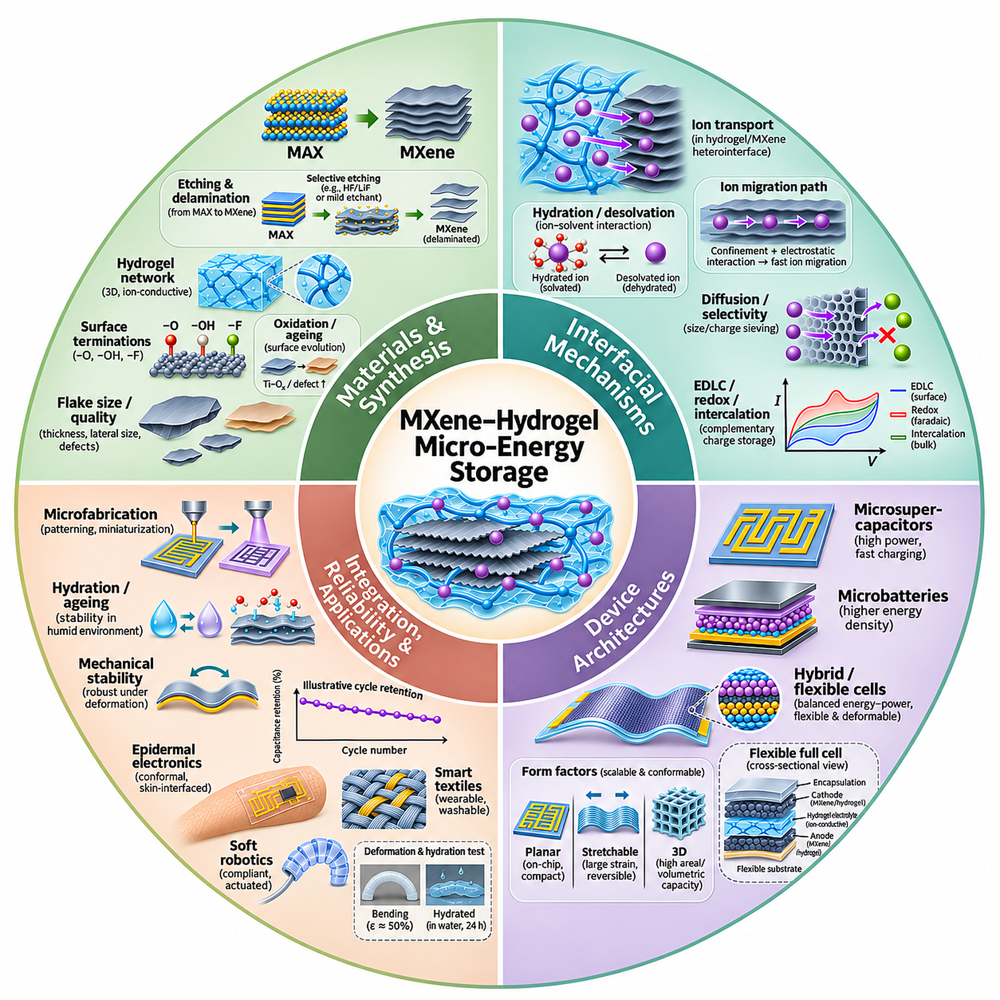
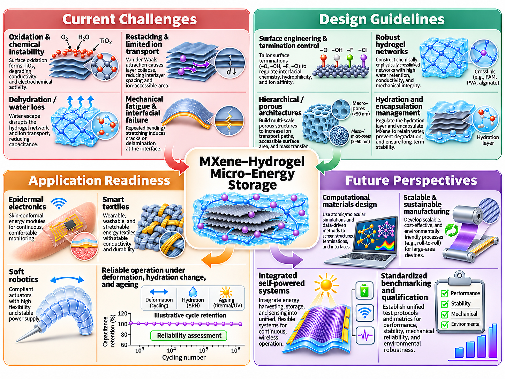

# MXene–Hydrogel Microsupercapacitors and Microbatteries for Reliable Wearable Power

This repository accompanies a structured narrative review of MXene–hydrogel microsupercapacitors (MSCs), hybrid microcells, and microbatteries for skin-mounted electronics, textiles, and soft machines. The review follows the material from precursor conversion and gelation through electrode fabrication, packaging, and operation under load. Its central comparison is the energy a complete device can deliver above its operating cutoff while it deforms, exchanges water with the environment, and ages. The supporting tables assemble published results and record the measurement conditions and normalization needed to interpret them.

## Repository guide

- [Supplementary materials](supplementary-materials/README.md) describes the collection and its evidence scope.
- [Figure index](supplementary-materials/figures/README.md) links all 20 captions and their panel guides. The opening and closing schematics have original-resolution JPEGs and editable PowerPoint files. Literature image crops are linked under the manuscript panel numbers where their reuse terms are documented.
- [Supporting tables](supplementary-materials/tables/README.md) describes the synthesis comparison, the full-cell benchmarks, and the observed-versus-ideal comparison. The [Table 1](supplementary-materials/tables/Table_1.csv), [Table 2](supplementary-materials/tables/Table_2.csv), and [Table 3](supplementary-materials/tables/Table_3.csv) CSVs retain their reported units and source basis.
- [References](supplementary-materials/references/README.md) includes the numbered bibliography and the RIS citation export. [Panel provenance](supplementary-materials/figures/panel-provenance.csv) records DOI, source panel, crop and rights information, pixel dimensions, and checksum for each published source crop.
- [Citation information](CITATION.cff) gives the author list for this supplementary collection.

## Scientific background

MXenes are two-dimensional transition-metal carbides, nitrides, or carbonitrides commonly described as Mₙ₊₁XₙTₓ. In a MAX precursor, Mₙ₊₁AXₙ, the A layer separates the carbide or nitride slabs. Selective A-layer removal and subsequent delamination produce flakes with surface terminations denoted by Tₓ. Precursor purity, the reaction pathway, washing, and storage determine the population of flakes available for gelation. Lateral dimensions and defects affect interflake resistance and packing. Terminations, residual ions, and interlayer water affect swelling, surface charge, ion coordination, and the accessible redox response. Ti₃C₂Tₓ provides much of the mechanistic evidence, while other carbide and nitride compositions test how far those relationships transfer. [Foundational Ti₃AlC₂ exfoliation](https://doi.org/10.1002/adma.201102306) · [In situ precursor conversion](https://doi.org/10.1002/advs.202408448) · [Surface terminations and charge storage](https://doi.org/10.1002/anie.202319238)

An MSC stores charge by double-layer formation and, in appropriate electrode–electrolyte combinations, fast Faradaic reactions at exposed sites or in accessible galleries. A microbattery uses paired reactions such as insertion, conversion, or metal deposition and stripping. A hybrid microcell can combine a capacitor-type Ti₃C₂Tₓ negative electrode with a battery-type V₂O₅ positive electrode in a ZnSO₄–polyacrylamide gel. Each electrode must accept the intended charge within its own stable potential window. The same MXene may function elsewhere as an electronically conductive phase, a deposition surface, or a dispersed electrolyte additive. Identifying that function is essential when comparing the reported cells. [Pseudocapacitive transition-metal carbides](https://doi.org/10.1038/nenergy.2017.105) · [Ti₃C₂Tₓ/V₂O₅ hybrid microcell](https://doi.org/10.1016/j.cej.2021.130965) · [MXene anode in a Zn–Br₂ microbattery](https://doi.org/10.1021/acs.jpclett.5c02342)

### Figure 1. Materials, mechanisms, device architectures, and wearable operation

The schematic connects material selection, hydrated interfacial transport and charge storage, device architecture, and qualification under use. The illustrated electrochemical curves and retention examples are conceptual. See the [caption, quadrant guide, original JPEG, and editable slide](supplementary-materials/figures/Figure-01/README.md).

## Research motivation

A wearable power source must satisfy a load with a specified voltage, pulse current, duty cycle, and recharge interval. A high-capacity cell can fall below a regulator threshold during a radio burst if internal or contact resistance produces excessive voltage sag. A compliant electrode can survive one stretch while a collector, seal, or interface degrades during repeated operation. Moisture exposure also differs between a skin patch, an intermittently laundered textile, and an actuator assembly. The mechanical path and the electrical path have to be evaluated together under the exposure and power schedule of the intended system. [Motion-powered sweat sensing](https://doi.org/10.1126/sciadv.aay9842) · [Contactless charging on skin](https://doi.org/10.1038/s41467-025-56881-z) · [Textile zinc-ion fiber battery](https://doi.org/10.1126/sciadv.abl3742)

Microscale geometry makes these constraints more acute. Narrow interdigitated gaps shorten ionic travel but leave less room for print variation, swelling, and electrolyte spreading. Increasing electrode loading can raise the low-rate charge per unit footprint while reducing the fraction accessible during a short pulse. A three-dimensional scaffold can improve access through a thick electrode, with a corresponding cost in occupied volume. Packaging, collectors, interconnects, and power conversion affect the energy available to the application. A comparison therefore needs the hydrated geometry, occupied footprint, discharge time, and cutoff, with the mass or volume boundary stated explicitly. [Monolithic MSC arrays and electrolyte placement](https://doi.org/10.1038/s41467-024-47216-5) · [Performance normalization](https://doi.org/10.1126/science.1213003)

## Why an engineered hydrogel matrix matters

A gel is a three-dimensional polymer network containing a liquid phase. In an aqueous hydrogel electrolyte, connected liquid regions accommodate dissolved ions while the network holds the electrolyte at the intended thickness and contact area. Polymer composition, crosslink density, swelling, and pore orientation determine the wetted geometry and how readily ions can move through it. Water content describes the amount of water present. Water activity describes its chemical availability, which can change with polymer–water and ion–water coordination. Retaining a given amount of water therefore leaves the mobility of solvated ions and the electrochemical stability of the interface to be measured. [Hydrogel electrolyte structure and electrical response](https://doi.org/10.3390/polym13081337) · [Lean-water zinc electrolyte](https://doi.org/10.1038/s41467-023-39634-8)

In a gel electrode, sheets can form electrically connected paths, and the hydrated network can hold those sheets apart or orient channels that give ions access to them. Hydrogen bonding, electrostatic interactions, coordination, and covalent attachment can influence flake dispersion, stress transfer, and contact resistance. Dispersion that interrupts sheet-to-sheet connectivity can reduce electronic conduction. Dense packing that helps along-plane conduction can restrict through-plane ion transport. Dense or conventionally filled polymer composites can reinforce or immobilize flakes, but achieving the same electrolyte uptake, compliant contact, and ion-accessible network depends on engineering the hydrated structure. Dry porosity and conductivity measurements capture part of the material state. The operating structure depends on electrolyte uptake, equilibration, and applied strain. [Mixed ionic and electronic transport](https://doi.org/10.1021/acsnano.3c06209) · [Ordered MXene hydrogel electrodes](https://doi.org/10.1002/advs.202101664) · [Printed MXene hydrogel architectures](https://doi.org/10.1038/s41467-022-34583-0)

The requirements depend on the layer. A gel electrode needs both electronic continuity and ion access to active material. A gel separator needs ionic continuity and electronic isolation through compression and swelling. An adhesive needs resistance to interfacial fatigue, and a barrier needs to retain hydration at a tolerable cost in stiffness. Reversible junctions can dissipate energy or reform after damage, while their relaxation can promote creep. Interpenetrating networks can allocate shape retention and energy dissipation to different network components. An appropriate control compares constituent or unfilled networks at matched hydration and compression and measures leakage where the gel separates electrodes. [Organic–inorganic conductive networks](https://doi.org/10.1002/advs.202403358) · [MXene–gelatin–polyacrylamide double networks](https://doi.org/10.3390/polym14235247) · [Hydrogel adhesion and fatigue](https://doi.org/10.1038/s41467-020-14871-3)

## Scientific and engineering challenges

- **Qualified flakes and repeatable gelation.** A synthesis route can recover converted solids while yielding a smaller fraction of flakes that can be dispersed, patterned, and retained in a wet electrode. Large sheets can reduce interflake junctions and can also clog or align during printing. Small sheets can disperse more evenly while adding junctions and exposed edges. Compare accepted flake-size distributions, residual species, oxidation state, and dispersion age through gelation and fabrication. Report attempted and accepted devices across independent lots to connect process changes to manufacturing yield. [Water-dispersible MXene from molten salts](https://doi.org/10.1016/j.isci.2021.103403) · [Aerosol-jet ink and resolution](https://doi.org/10.1002/smtd.202500499)
- **Transport and charge-storage assignment.** Electronic current follows flakes, junctions, and collector contacts. Ion motion depends on liquid composition, channel connectivity, solvation, and potential. A broad voltammogram can contain double-layer charge, surface redox, and reversible insertion. Potential-resolved Ti and Cu measurements in a defined liquid-electrolyte system established coupled MXene host and intercalated guest redox under those conditions. To transfer that assignment to a gel microcell, compare equilibrated gel and composition-matched liquid controls while measuring chemical state and structural or mass changes across the same potential window. Swelling can change gallery spacing independently of electron transfer. [Coupled Cu and Ti redox](https://doi.org/10.1021/acsnano.3c12989) · [In situ confined water](https://doi.org/10.1073/pnas.2108325118) · [Monolayer surface pseudocapacitance](https://doi.org/10.1038/s41467-023-35950-1)
- **Chemical aging, hydration, and mechanical damage.** Oxidation changes MXene composition and connectivity. Evaporation concentrates salt and contracts the gel, while water uptake can swell separators and weaken adhesion. A crack at a collector, tab, or seal can remove useful output even when conductivity recovers within a gel specimen. Track cell mass, local strain, contact resistance, leakage, and loaded terminal energy on the same device through representative humidity, deformation, and cycling. A healing evaluation should define the damage, allowed recovery time, and energy delivered after repair. [Oxidation in aqueous MXene dispersions](https://doi.org/10.1039/d4sc05097e) · [Conductivity hysteresis and confined water](https://doi.org/10.1038/s41467-025-62892-7)
- **Device balance and integration.** A zinc-metal cell must maintain transport and reversible deposition while limiting corrosion, gas generation, parasitic phases, and irreversible loss of active inventory. Symmetric-cell polarization tests address an interface under specified conditions. Finite inventory and capacity loss require a balanced complete cell. Wearable qualification adds charge-transfer losses from the harvester or receiver, standby consumption, and losses in interconnects and converters. Measure voltage and current at both the cell and regulated rail through representative recharge and load cycles. [Anisotropic ion transport in zinc gels](https://doi.org/10.1073/pnas.2322944121) · [Flexible zinc cells with a hierarchical gel](https://doi.org/10.1007/s40820-026-02246-0) · [Integrated contactless charging](https://doi.org/10.1038/s41467-025-56881-z)

### Figure 20. Research challenges, design guidance, and qualification

The design guidance relates failure mechanisms to terminations, connected pore structures, crosslinked networks, and hydration barriers. The application and future-research quadrants indicate what to measure in a packaged device or production workflow. See the [caption, quadrant guide, original JPEG, and editable slide](supplementary-materials/figures/Figure-20/README.md).

## Why this review is needed

Earlier reviews established MXene hydrogel chemistry, printing constraints in MXene MSCs, and approaches to flexible integration. The measurements that inform design remain distributed across different test boundaries. Surface spectroscopy can identify a reaction at a model electrode. A device discharge determines the usable energy of a complete cell under defined conditions. An operating wearable adds packaging, power conversion, and the duty cycle of its load. This review connects those boundaries through precursor and termination chemistry, network architecture, fabrication, and device operation. Comparators based on printed graphene, carbon–zinc microbatteries, and TiS₂-containing insertion electrodes help identify which benefits arise from the lamellar host, the conducting scaffold, or the hydrated interface. [MXene hydrogel fundamentals](https://doi.org/10.1039/d0cs00022a) · [MXene MSC design and integration](https://doi.org/10.1021/acsnano.3c10246) · [Printed graphene cells](https://doi.org/10.1039/c9nr01427f) · [Carbon–zinc gel microbattery](https://doi.org/10.1021/acsami.5c05599) · [MXene–TiS₂ zinc-ion microbattery](https://doi.org/10.1016/j.jpowsour.2021.230076)

The manuscript reports targeted literature searches for MXene, gel electrolytes, microscale storage, and wearable operation, with publisher records, Crossref, and Europe PubMed Central used for verification through 11 November 2026. It groups evidence as Tier A for complete microcells with a defined MXene role and hydrated gel component, Tier B for larger complete cells or microcells that contain one of those features, Tier C for component and interface experiments, and Tier D for external comparators and transferable methods. Load operation is recorded separately. Multiple panels from one paper share an evidence source. The benchmark records preserve the source geometry, electrolyte, duty conditions, and units where reported.

The selection framework starts from the required terminal voltage, current, and operating duration. A regularly recharged pulse load favors evaluating an MSC against its resistance, leakage, and voltage span. A longer discharge motivates testing a balanced microbattery under that load. A hybrid also needs compatible electrode windows under aging. For any of these architectures, a first useful comparison holds occupied footprint, load waveform, cutoff, and environmental history fixed. Priority experiments examine matched gel and liquid interfaces, vary electrolyte formulation and electrode geometry independently, and test packaged cells under simultaneous deformation and humidity. Modeling and active learning can guide candidate selection when the predictors are validated against wet-state transport, leakage, loaded discharge, and replication across batches. A demonstrated optimization of a dried MXene aerogel, for example, supports selection against the measured aerogel targets. Its use in hydrated storage calls for measurements at the cell boundary. [Stable MXene selection by active learning](https://doi.org/10.1021/acsnano.4c08621) · [Model-guided MXene aerogels](https://doi.org/10.1038/s41467-024-49011-8)

## Repository maintainer

Ashraf, University of Saskatchewan

[Advanced Science — 2026 repository](https://github.com/mawaisashraf3/Advanced-Science--2026)
