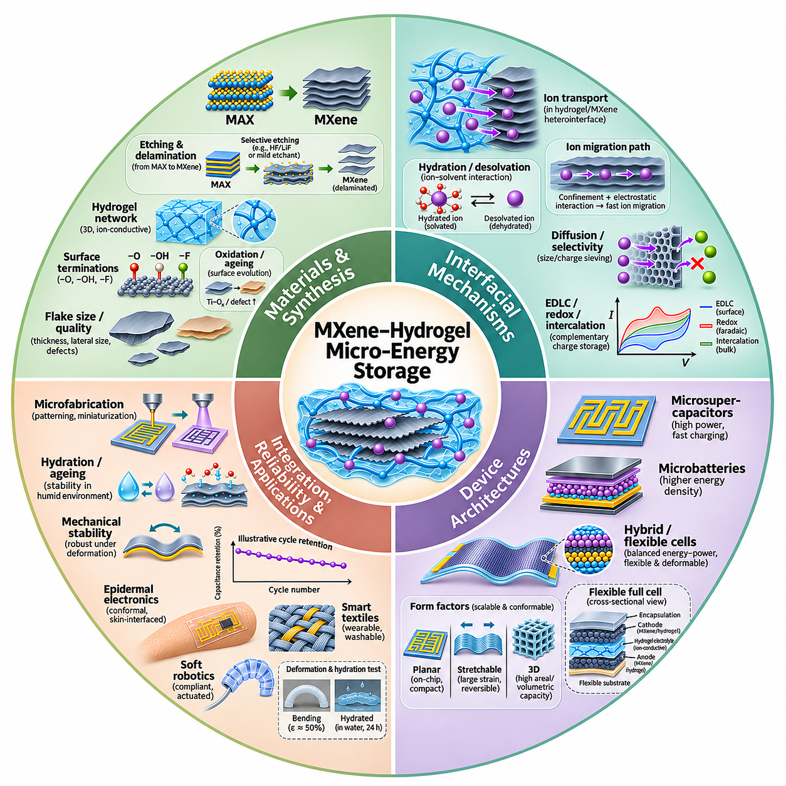

# Figure 1. Schematic overview of the material development, fundamental operating principles, device configurations, and application requirements of MXene–hydrogel-based micro-energy storage systems

[Figure index](../README.md) · [Bibliography](../../references/bibliography.md)

[Original JPEG (5,016 × 5,016 px)](Figure-01.jpg) · [Editable PowerPoint](Figure-01.pptx)

## Caption

**Materials and synthesis.** The upper-left quadrant traces selective conversion of a layered MAX precursor and delamination to MXene flakes. Terminal groups, oxidation and ageing, flake dimensions, and the hydrated polymer network define the feedstock state.

**Interfacial mechanisms.** The upper-right quadrant shows hydration and partial desolvation, ion paths through confined domains, and selectivity due to size and charge. The small electrochemical plot illustrates double-layer, redox, and intercalation contributions.

**Device architectures.** The lower-right quadrant shows interdigitated microsupercapacitors, layered microbatteries, hybrid cells, and planar, stretchable, and three-dimensional layouts. A flexible cell cross-section locates the substrate, electrodes, hydrogel electrolyte, and encapsulation.

**Integration, reliability, and applications.** The lower-left quadrant links microfabrication, mechanical loading, water exchange, and ageing with epidermal patches, textiles, and soft robots. The curve and test icons illustrate potential qualification variables.

## Attribution

The manuscript credits the author with creating and finalizing this schematic in PowerPoint. It discloses AI assistance for conceptual planning and visual layout. The visual contains idealized mechanisms and illustrative plots.

## Scientific explanation

**Research framework.** The four quadrants connect precursor and flake quality to hydrated interfacial transport, microcell geometry, and electrical service under wear. The illustrated voltammograms, retention curve, and deformation and hydration examples are conceptual test variables.
