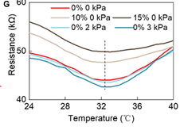
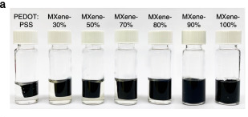
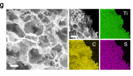
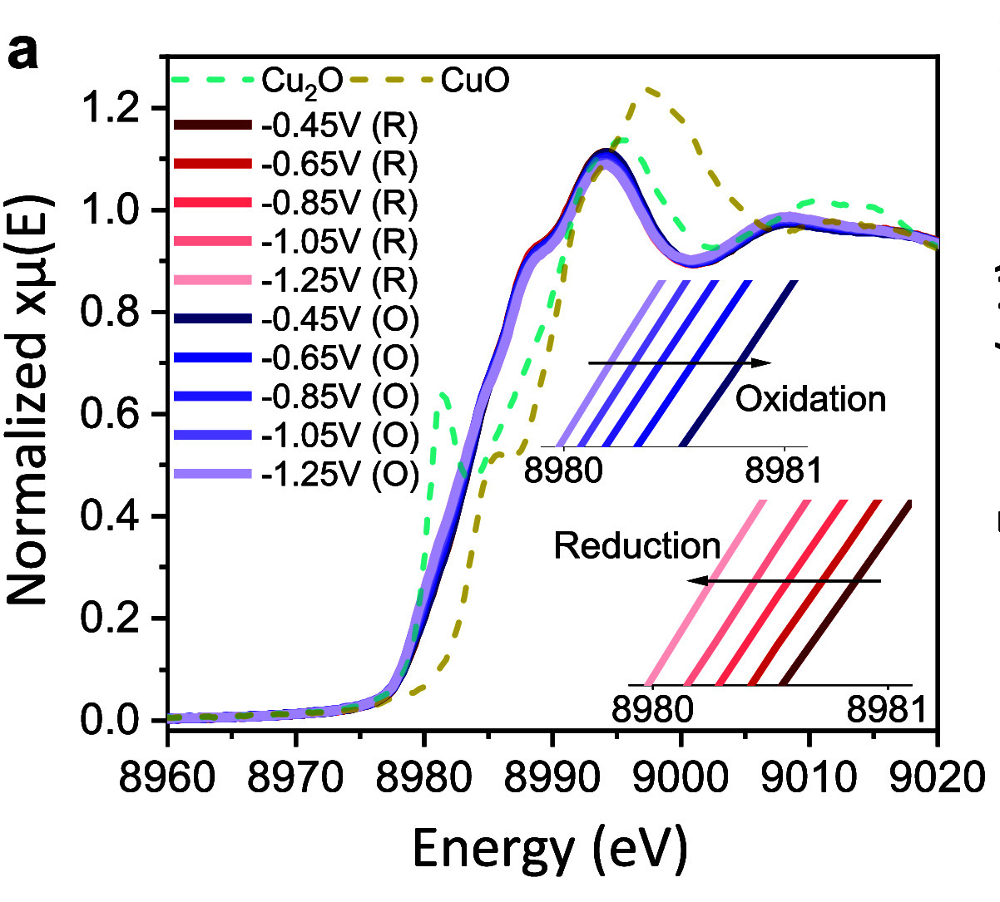
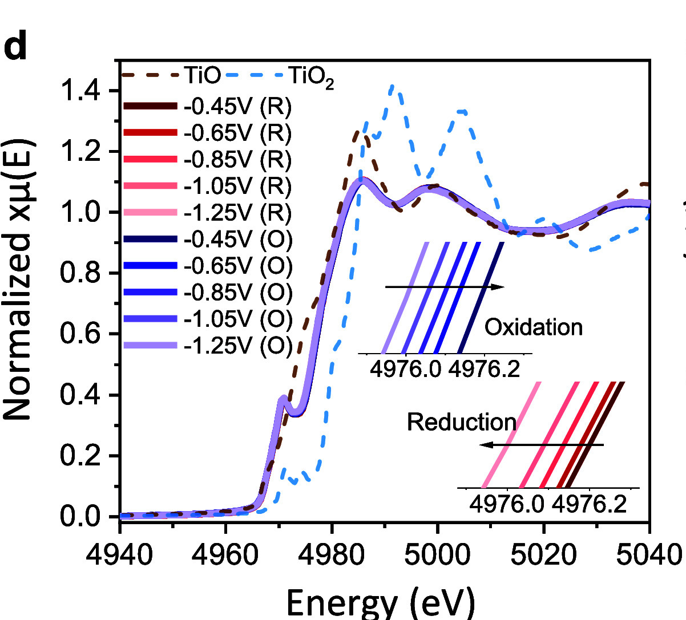
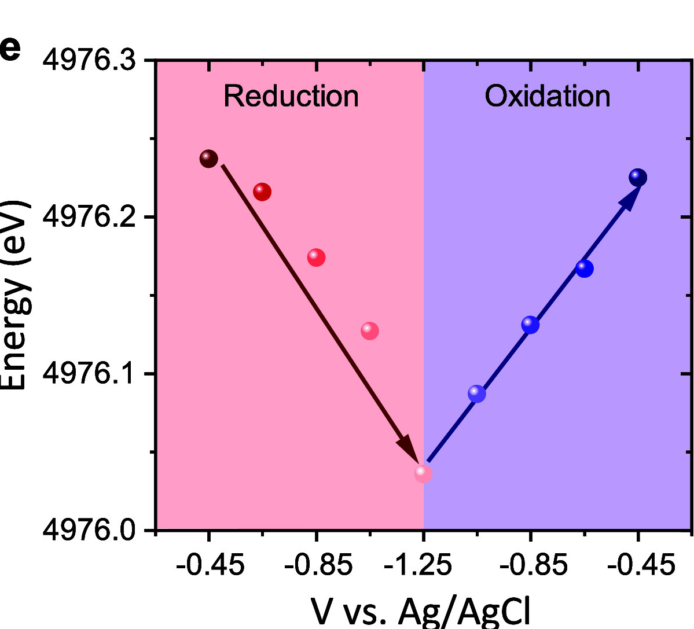
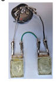
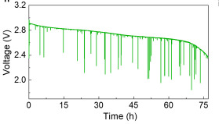

# Figure 2. Framework linking MXene–hydrogel materials to wearable micro-energy systems

[Figure index](../README.md) · [Bibliography](../../references/bibliography.md)

## Caption

The panel labels below follow the manuscript. Available source crops are embedded under their corresponding labels.

## Panel guide

### (a) Wearable operating environments

**(a1)** Temperature-dependent resistance of a wearable MXene hydrogel sensor under superposed strain and pressure [[30]](../../references/bibliography.md#ref-30).

Source [[30]](../../references/bibliography.md#ref-30) (Fig. 4., panel G). Cropped from the publisher figure. [CC BY 4.0](https://creativecommons.org/licenses/by/4.0/). [Full attribution and crop record](../panel-provenance.csv).

**(a2)** Garment-integrated fiber battery architecture and layer positions.

**(a3)** Bending-dependent retention and stress fields for the fiber assembly [[6]](../../references/bibliography.md#ref-6).

### (b) Hydrated materials and printing

**(b1)** MXene and PEDOT:PSS hydrogel formulations at different compositions.

Source [[11]](../../references/bibliography.md#ref-11) (Fig. 2, panel a). Cropped from the publisher figure. [CC BY 4.0](https://creativecommons.org/licenses/by/4.0/). [Full attribution and crop record](../panel-provenance.csv).

**(b2)** Microscopy and elemental mapping of the Ti₃C₂Tₓ composite network [[11]](../../references/bibliography.md#ref-11).

Source [[11]](../../references/bibliography.md#ref-11) (Fig. 2, panel g). Cropped from the publisher figure. [CC BY 4.0](https://creativecommons.org/licenses/by/4.0/). [Full attribution and crop record](../panel-provenance.csv).

### (c) Charge storage at the interface

**(c1)** Potential-dependent copper-edge spectra of Cu-intercalated Ti₃C₂Tₓ.

Source [[31]](../../references/bibliography.md#ref-31) (Figure 4, panel a). Cropped from the publisher figure. [CC BY 4.0](https://creativecommons.org/licenses/by/4.0/). [Full attribution and crop record](../panel-provenance.csv).

**(c2)** Corresponding titanium-edge spectra.

Source [[31]](../../references/bibliography.md#ref-31) (Figure 4, panel d). Cropped from the publisher figure. [CC BY 4.0](https://creativecommons.org/licenses/by/4.0/). [Full attribution and crop record](../panel-provenance.csv).

**(c3)** Reversible titanium edge shift across the potential sweep [[31]](../../references/bibliography.md#ref-31).

Source [[31]](../../references/bibliography.md#ref-31) (Figure 4, panel e). Cropped from the publisher figure. [CC BY 4.0](https://creativecommons.org/licenses/by/4.0/). [Full attribution and crop record](../panel-provenance.csv).

### (d) Operation of an electrical load

**(d1)** Printed carbon–zinc microbattery pair wired to the demonstration load.

Source [[22]](../../references/bibliography.md#ref-22) (Figure 4, panel g). Cropped from the publisher figure. [CC BY 4.0](https://creativecommons.org/licenses/by/4.0/). [Full attribution and crop record](../panel-provenance.csv).

**(d2)** Terminal voltage history of the powered system [[22]](../../references/bibliography.md#ref-22).

Source [[22]](../../references/bibliography.md#ref-22) (Figure 4, panel h). Cropped from the publisher figure. [CC BY 4.0](https://creativecommons.org/licenses/by/4.0/). [Full attribution and crop record](../panel-provenance.csv).

### (e) Multimodal hydrogel sensing and readout

**(e1)** Responses to controlled mixed temperature, pressure and sweat stimuli in a hydrogel e-skin comparator.

**(e2)** Wristband and reference readings across the reported activity conditions.

**(e3)** User interface for the wearable signal readout [[32]](../../references/bibliography.md#ref-32).

### (f) Strain-tolerant charging and an electrical load

**(f1)** Photographs of the MXene microsupercapacitor at three applied strains.

**(f2)** Microsupercapacitor cyclic voltammetry at the reported applied strains.

**(f3)** Wireless charging, discharge and LED operation under two strain conditions [[33]](../../references/bibliography.md#ref-33). The sensing and charging examples test different functions. Their outputs address distinct steps between a hydrated material and an operating wearable.

## Source and reuse notes

Manuscript source references for the figure are [[6]](../../references/bibliography.md#ref-6), [[11]](../../references/bibliography.md#ref-11), [[22]](../../references/bibliography.md#ref-22), [[30]](../../references/bibliography.md#ref-30), [[31]](../../references/bibliography.md#ref-31), [[32]](../../references/bibliography.md#ref-32), [[33]](../../references/bibliography.md#ref-33).

The published crops carry source-specific Creative Commons terms. For the complete literature montage and any panel without an embedded crop, consult the cited source figure. The supplied manuscript credit language covers its figure references. The original montage files combine panels with different reuse terms.

[Attribution and crop metadata for the shared panels](../panel-provenance.csv).

Manuscript source credits

a1 reproduced with permission from Ref. [[30]](../../references/bibliography.md#ref-30) (© 2023 Wu et al. (Science and Technology Review Publishing House), CC BY 4.0). a2–a3 reproduced with permission from Ref. [[6]](../../references/bibliography.md#ref-6). Copyright 2021, AAAS. b1–b2 reproduced with permission from Ref. [[11]](../../references/bibliography.md#ref-11) Copyright 2022 Springer Nature. c1–c3 reproduced with permission from Ref. [[31]](../../references/bibliography.md#ref-31) Copyright 2024American Chemical Societ. d1–d2 reproduced with permission from Ref. [[22]](../../references/bibliography.md#ref-22) Copyright 2025 American Chemical Society. e1–e3 reproduced with permission from Ref. [[32]](../../references/bibliography.md#ref-32). Copyright 2026, Springer Nature. f1–f3 reproduced with permission from Ref. [[33]](../../references/bibliography.md#ref-33). Copyright 2026, Springer Nature.

## Scientific explanation

**Evidence across measurement levels.** The panels connect materials characterization to a wired or wireless demonstration across different studies. Temperature sensing, spectroscopic interpretation, cell deformation, and actual load operation answer different questions. Follow the electrical path and test conditions before carrying a claim from one level to another.
