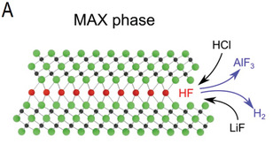
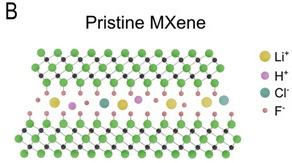
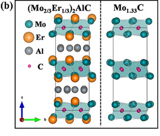
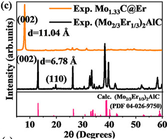
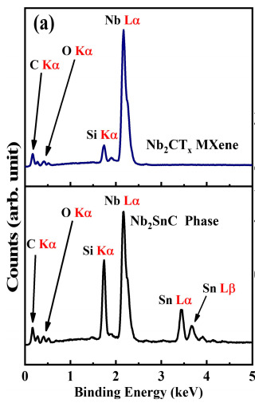
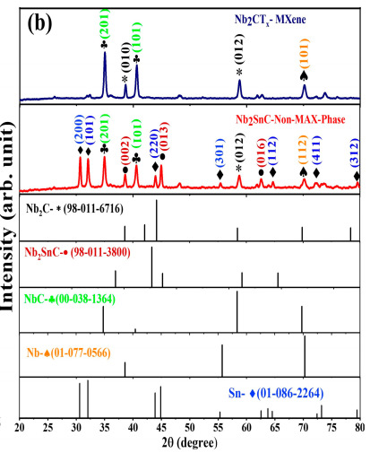

# Figure 3. MAX precursor structure and selective conversion to MXene

[Figure index](../README.md) · [Bibliography](../../references/bibliography.md)

## Caption

The panel labels below follow the manuscript. Available source crops are embedded under their corresponding labels.

## Panel guide

### (a) Selective aluminium removal

**(a1)** Idealized layered Ti₃AlC₂ before selective Al removal in the LiF/HCl reaction.

Source [[38]](../../references/bibliography.md#ref-38) (Figure 5, panel A). Cropped from the publisher figure. [CC BY 4.0](https://creativecommons.org/licenses/by/4.0/). [Full attribution and crop record](../panel-provenance.csv).

**(a2)** Model of the etched Ti₃C₂Tₓ gallery and associated species [[38]](../../references/bibliography.md#ref-38).

Source [[38]](../../references/bibliography.md#ref-38) (Figure 5, panel B). Cropped from the publisher figure. [CC BY 4.0](https://creativecommons.org/licenses/by/4.0/). [Full attribution and crop record](../panel-provenance.csv).

### (b) Competing reaction paths

**(b1)** calculated reaction free energies for Ti₃AlC₂ in ZnCl₂ at 800 K.

**(b2)** calculated reaction free energies at 1000 K [[37]](../../references/bibliography.md#ref-37).

### (c) Ordered carbide and product

**(c1)** Atomic arrangements of the rare-earth i-MAX phase and its derived carbide.

Source [[40]](../../references/bibliography.md#ref-40) (Figure 1, panel b). Cropped from the publisher figure. [CC BY 4.0](https://creativecommons.org/licenses/by/4.0/). [Full attribution and crop record](../panel-provenance.csv).

**(c2)** Diffraction comparison of the i-MAX precursor and Mo₁.₃₃C@Er product [[40]](../../references/bibliography.md#ref-40).

Source [[40]](../../references/bibliography.md#ref-40) (Figure 1, panel c). Cropped from the publisher figure. [CC BY 4.0](https://creativecommons.org/licenses/by/4.0/). [Full attribution and crop record](../panel-provenance.csv).

### (d) Nitride sheet morphology

**(d1)** Electron micrograph of the layered V₂NTₓ product at the micrometre scale.

**(d2)** Higher magnification of the layered nitride with the source EDS inset [[42]](../../references/bibliography.md#ref-42).

### (e) Non-MAX boundary case

**(e1)** Elemental spectra comparing Nb₂SnC and the Nb₂CTₓ product.

Source [[43]](../../references/bibliography.md#ref-43) (Figure 2, panel a). Cropped from the publisher figure. [CC BY 4.0](https://creativecommons.org/licenses/by/4.0/). [Full attribution and crop record](../panel-provenance.csv).

**(e2)** Diffraction and phase markers for the non-MAX precursor and Nb₂CTₓ [[43]](../../references/bibliography.md#ref-43).

Source [[43]](../../references/bibliography.md#ref-43) (Figure 2, panel b). Cropped from the publisher figure. [CC BY 4.0](https://creativecommons.org/licenses/by/4.0/). [Full attribution and crop record](../panel-provenance.csv).

### (f) Before etching and after delamination [[44]](../../references/bibliography.md#ref-44)

**(f1)** Parent Ti₃AlC₂ particles in the molten-salt synthesis study.

**(f2)** Delaminated Ti₃C₂Tz nanosheets drop-cast from the final dispersion.

### (g) Calculated criteria for selective exfoliation [[45]](../../references/bibliography.md#ref-45)

**(g1)** Model of the competing exfoliation and side-phase reaction paths during HF treatment.

**(g2)** Vacancy-formation-energy signs proposed for selective A-site extraction and framework stability. The proposed vacancy-energy conditions are model descriptors. Measured phase identity and morphology are still required for the product obtained under a particular etch protocol.

## Source and reuse notes

Manuscript source references for the figure are [[37]](../../references/bibliography.md#ref-37), [[38]](../../references/bibliography.md#ref-38), [[40]](../../references/bibliography.md#ref-40), [[42]](../../references/bibliography.md#ref-42), [[43]](../../references/bibliography.md#ref-43), [[44]](../../references/bibliography.md#ref-44), [[45]](../../references/bibliography.md#ref-45).

The published crops carry source-specific Creative Commons terms. For the complete literature montage and any panel without an embedded crop, consult the cited source figure. The supplied manuscript credit language covers its figure references. The original montage files combine panels with different reuse terms.

[Attribution and crop metadata for the shared panels](../panel-provenance.csv).

Manuscript source credits

a1–a2 reproduced with permission from Ref. [[38]](../../references/bibliography.md#ref-38) Copyright 2024, Wiley-VCH GmbH. b1–b2 adapted with permission from Ref. [[37]](../../references/bibliography.md#ref-37). Copyright 2025, Wiley-VCH GmbH. c1–c2 reproduced with permission from Ref. [[40]](../../references/bibliography.md#ref-40) Copyright 2026, American Chemical Society. d1–d2 reproduced with permission from Ref. [[42]](../../references/bibliography.md#ref-42). Copyright 2020, American Chemical Society. e1–e2 reproduced with permission from Ref. [[43]](../../references/bibliography.md#ref-43) Copyright 2023, MDPI. f1–f2 reproduced with permission from Ref. [[44]](../../references/bibliography.md#ref-44). Copyright 2021, Elsevier. g1–g2 reproduced with permission from Ref. [[45]](../../references/bibliography.md#ref-45) Copyright 2025, Springer Nature.

## Scientific explanation

**Precursor chemistry.** Selective extraction depends on the energetic and structural cost of removing the intervening layer while retaining the carbide or nitride framework. Calculated reaction energies, diffraction, microscopy, and elemental spectra constrain different aspects of conversion. Residual phases and termination chemistry still require measurement before a product is selected for a gel.
