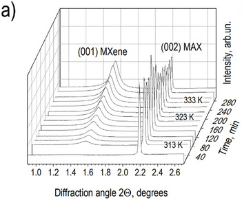
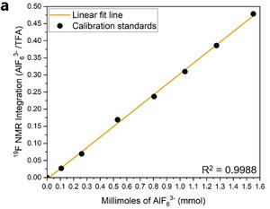
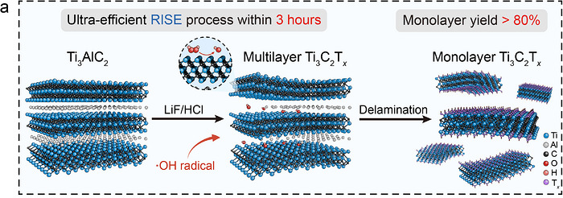
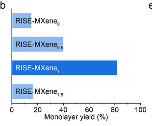
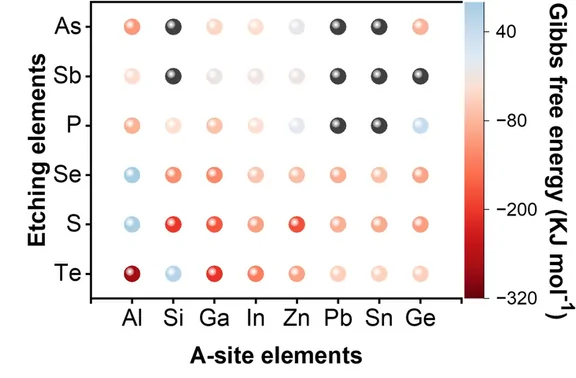
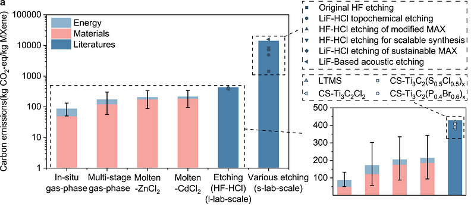

# Figure 4. Comparative synthesis routes and process-selection map for MXenes

[Figure index](../README.md) · [Bibliography](../../references/bibliography.md)

## Caption

The panel labels below follow the manuscript. Available source crops are embedded under their corresponding labels.

## Panel guide

### (a) A-layer removal across reaction routes

**(a1)** Selected in situ diffraction patterns during LiF/HCl etching [[38]](../../references/bibliography.md#ref-38).

Source [[38]](../../references/bibliography.md#ref-38) (Figure 1, panel a). Cropped from the publisher figure. [CC BY 4.0](https://creativecommons.org/licenses/by/4.0/). [Full attribution and crop record](../panel-provenance.csv).

**(a2)** Fluorine NMR calibration for quantifying Al–fluoride species in an alternative fluoride etch [[58]](../../references/bibliography.md#ref-58).

Source [[58]](../../references/bibliography.md#ref-58) (FIGURE 5, panel a). Cropped from the publisher figure. [CC BY 4.0](https://creativecommons.org/licenses/by/4.0/). [Full attribution and crop record](../panel-provenance.csv).

**(a3)** Sequential flash Joule heating with chlorination and fluorination, shown in the publisher's reaction schematic [[57]](../../references/bibliography.md#ref-57).

### (b) Pulsed electrochemical etching

**(b1)** Current response during anodic etching with periodic reverse pulses.

**(b2)** Microscopy of the etched precursor under the labeled processing condition.

**(b3)** Diffraction comparison for pulsed and unpulsed processing [[52]](../../references/bibliography.md#ref-52).

### (c) Reaction selection and isolated yield

**(c1)** Schematic separation of conversion and delamination in the RISE workflow.

Source [[59]](../../references/bibliography.md#ref-59) (FIGURE 1, panel a). Cropped from the publisher figure. [CC BY 4.0](https://creativecommons.org/licenses/by/4.0/). [Full attribution and crop record](../panel-provenance.csv).

**(c2)** Reported monolayer yield across the studied conditions [[59]](../../references/bibliography.md#ref-59).

Source [[59]](../../references/bibliography.md#ref-59) (FIGURE 1, panel b). Cropped from the publisher figure. [CC BY 4.0](https://creativecommons.org/licenses/by/4.0/). [Full attribution and crop record](../panel-provenance.csv).

**(c3)** Calculated reaction free energies for combinations of etchant and A-site element at the source temperature [[41]](../../references/bibliography.md#ref-41).

Source [[41]](../../references/bibliography.md#ref-41) (Fig. 1, panel b). Cropped from the publisher figure. [CC BY 4.0](https://creativecommons.org/licenses/by/4.0/). [Full attribution and crop record](../panel-provenance.csv).

### (d) Product recovery and process burden

**(d1)** Electron microscopy of the recovered delaminated nanosheet.

**(d2)** Diffraction comparison across washing and final dispersion steps [[44]](../../references/bibliography.md#ref-44).

**(d3)** Source-model comparison of carbon emissions per mass of synthesized MXene for alternative routes [[60]](../../references/bibliography.md#ref-60).

Source [[60]](../../references/bibliography.md#ref-60) (FIGURE 2, panel a). Cropped from the publisher figure. [CC BY 4.0](https://creativecommons.org/licenses/by/4.0/). [Full attribution and crop record](../panel-provenance.csv).

### (e) Deep-eutectic-solvent etching and delamination

**(e1)** Proposed sequence for concurrent MAX conversion and sheet separation before acid washing [[61]](../../references/bibliography.md#ref-61).

**(e2)** proposed gas-driven expansion mechanism during deep-eutectic-solvent conversion

### (f) Other routes and product verification

**(f1)** calculated sequence of iodine-assisted aluminium removal from the MAX precursor [[62]](../../references/bibliography.md#ref-62).

**(f2)** XRD of radical-intensified versus minimally intensive layer delamination products [[59]](../../references/bibliography.md#ref-59). Coupled delamination changes the process boundary. Comparisons of time, yield or waste must include finishing and separation at a specified product quality.

## Source and reuse notes

Manuscript source references for the figure are [[38]](../../references/bibliography.md#ref-38), [[41]](../../references/bibliography.md#ref-41), [[44]](../../references/bibliography.md#ref-44), [[52]](../../references/bibliography.md#ref-52), [[57]](../../references/bibliography.md#ref-57), [[58]](../../references/bibliography.md#ref-58), [[59]](../../references/bibliography.md#ref-59), [[60]](../../references/bibliography.md#ref-60), [[61]](../../references/bibliography.md#ref-61), [[62]](../../references/bibliography.md#ref-62).

The published crops carry source-specific Creative Commons terms. For the complete literature montage and any panel without an embedded crop, consult the cited source figure. The supplied manuscript credit language covers its figure references. The original montage files combine panels with different reuse terms.

[Attribution and crop metadata for the shared panels](../panel-provenance.csv).

Manuscript source credits

a1 reproduced with permission from Ref. [[38]](../../references/bibliography.md#ref-38) Copyright 2024, Wiley-VCH GmbH. a2 reproduced with permission from Ref. [[58]](../../references/bibliography.md#ref-58) Copyright, 2026, Wiley-VCH GmbH. a3 reproduced with permission from Ref. [[57]](../../references/bibliography.md#ref-57). Copyright 2026, Springer Nature Limited. b1–b3 reproduced with permission from Ref. [[52]](../../references/bibliography.md#ref-52). Copyright 2025, Wiley-VCH GmbH. c1–c2, f2 reproduced with permission from Ref. [[59]](../../references/bibliography.md#ref-59) Copyright, 2026, Wiley-VCH GmbH. c3 reproduced with permission from Ref. [[41]](../../references/bibliography.md#ref-41) Copyright, 2025, Springer Nature. d1–d2 reproduced with permission from Ref. [[44]](../../references/bibliography.md#ref-44). Copyright 2021, Elsevier. d3 reproduced with permission from Ref. [[60]](../../references/bibliography.md#ref-60)Copyright 2026, Wiley-VCH GmbH. e1–e2 reproduced with permission from Ref. [[61]](../../references/bibliography.md#ref-61). Copyright 2026, Springer Nature Limited. f1 reproduced with permission from Ref. [[62]](../../references/bibliography.md#ref-62). Copyright 2021, Wiley-VCH GmbH.

## Scientific explanation

**Process selection.** A short precursor-conversion time has limited value if washing, separation, or dispersion qualification controls the process. The figure pairs measurements and proposed reaction pathways so that conversion, isolated yield, and usable wet feedstock can be evaluated separately. Table 1 expands the comparison to routes and downstream checks outside the selected panels.
