# Figure 5. MXene composition, quality descriptors, and carbon/2D benchmark landscape

[Figure index](../README.md) · [Bibliography](../../references/bibliography.md)

## Caption

The panel labels below follow the manuscript. Available source crops are embedded under their corresponding labels.

## Panel guide

### (a) Interlayer chemistry across MXenes

**(a1)** Diffraction comparison for Nb₄C₃Tₓ before and after halide treatment.

[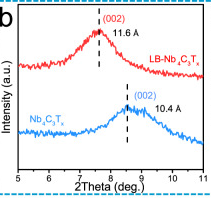](panels/panel-a1.png)

Source [[71]](../../references/bibliography.md#ref-71) (Fig. 3, panel b). Cropped from the publisher figure. [CC BY 4.0](https://creativecommons.org/licenses/by/4.0/). [Full attribution and crop record](../panel-provenance.csv).

**(a2)** Diffraction comparison for Mo₂Ti₂C₃Tₓ.

[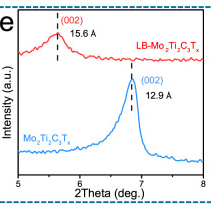](panels/panel-a2.png)

Source [[71]](../../references/bibliography.md#ref-71) (Fig. 3, panel e). Cropped from the publisher figure. [CC BY 4.0](https://creativecommons.org/licenses/by/4.0/). [Full attribution and crop record](../panel-provenance.csv).

**(a3)** Diffraction comparison for Ti₃C₂Tₓ [[71]](../../references/bibliography.md#ref-71).

[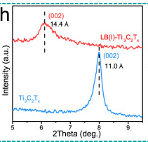](panels/panel-a3.png)

Source [[71]](../../references/bibliography.md#ref-71) (Fig. 3, panel h). Cropped from the publisher figure. [CC BY 4.0](https://creativecommons.org/licenses/by/4.0/). [Full attribution and crop record](../panel-provenance.csv).

### (b) Calculated termination structures

**(b1)** The unlettered side-view model series compares bare and functionalized Y₂VC₂ structures using a common legend [[72]](../../references/bibliography.md#ref-72).

### (c) Nanosheets and a cellulose co-phase

**(c1)** Transmission electron micrograph of the cellulose nanofibril phase.

**(c2)** Transmission electron micrograph of the Ti₃C₂Tₓ sheet [[73]](../../references/bibliography.md#ref-73).

### (d) Flake-size effects on film texture

**(d1)** Azimuthal intensity distribution for the large-flake film.

[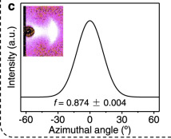](panels/panel-d1.png)

Source [[18]](../../references/bibliography.md#ref-18) (Fig. 2, panel c). Cropped from the publisher figure. [CC BY 4.0](https://creativecommons.org/licenses/by/4.0/). [Full attribution and crop record](../panel-provenance.csv).

**(d2)** Azimuthal intensity distribution for the small-flake film.

[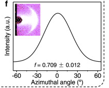](panels/panel-d2.png)

Source [[18]](../../references/bibliography.md#ref-18) (Fig. 2, panel f). Cropped from the publisher figure. [CC BY 4.0](https://creativecommons.org/licenses/by/4.0/). [Full attribution and crop record](../panel-provenance.csv).

**(d3)** Azimuthal intensity distribution for the intercalated dual-size film [[18]](../../references/bibliography.md#ref-18).

[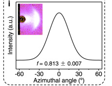](panels/panel-d3.png)

Source [[18]](../../references/bibliography.md#ref-18) (Fig. 2, panel i). Cropped from the publisher figure. [CC BY 4.0](https://creativecommons.org/licenses/by/4.0/). [Full attribution and crop record](../panel-provenance.csv).

### (e) Ordered precursor quality

**(e1)** Selective treatment of the rare-earth ordered MAX material.

[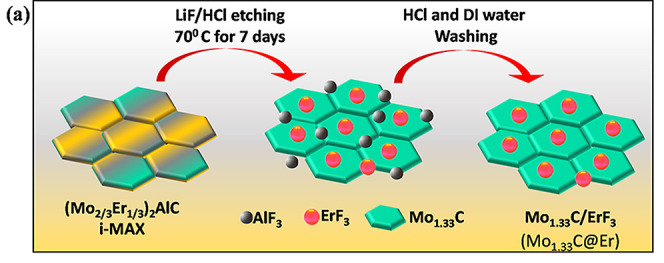](panels/panel-e1.png)

Source [[40]](../../references/bibliography.md#ref-40) (Figure 1, panel a). Cropped from the publisher figure. [CC BY 4.0](https://creativecommons.org/licenses/by/4.0/). [Full attribution and crop record](../panel-provenance.csv).

**(e2)** Raman spectra of the precursor and derived material.

[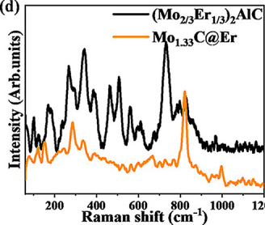](panels/panel-e2.png)

Source [[40]](../../references/bibliography.md#ref-40) (Figure 1, panel d). Cropped from the publisher figure. [CC BY 4.0](https://creativecommons.org/licenses/by/4.0/). [Full attribution and crop record](../panel-provenance.csv).

**(e3)** Microscopy of the rare-earth-containing carbide product [[40]](../../references/bibliography.md#ref-40).

[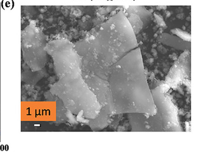](panels/panel-e3.png)

Source [[40]](../../references/bibliography.md#ref-40) (Figure 1, panel e). Cropped from the publisher figure. [CC BY 4.0](https://creativecommons.org/licenses/by/4.0/). [Full attribution and crop record](../panel-provenance.csv).

### (f) Carbon scaffold comparator

**(f1)** Cross-section of the MnO₂ coating on the printed graphene scaffold.

[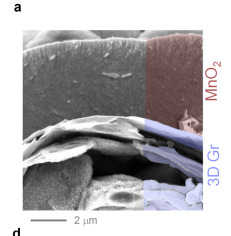](panels/panel-f1.png)

Source [[22]](../../references/bibliography.md#ref-22) (Figure 3, panel a). Cropped from the publisher figure. [CC BY 4.0](https://creativecommons.org/licenses/by/4.0/). [Full attribution and crop record](../panel-provenance.csv).

**(f2)** Transmission electron micrograph of the oxide nanosheet.

[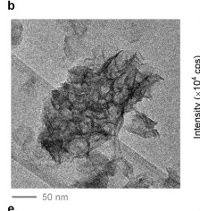](panels/panel-f2.png)

Source [[22]](../../references/bibliography.md#ref-22) (Figure 3, panel b). Cropped from the publisher figure. [CC BY 4.0](https://creativecommons.org/licenses/by/4.0/). [Full attribution and crop record](../panel-provenance.csv).

**(f3)** Mn 2p X-ray photoelectron spectrum from the carbon-supported oxide [[22]](../../references/bibliography.md#ref-22).

[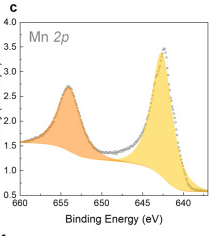](panels/panel-f3.png)

Source [[22]](../../references/bibliography.md#ref-22) (Figure 3, panel c). Cropped from the publisher figure. [CC BY 4.0](https://creativecommons.org/licenses/by/4.0/). [Full attribution and crop record](../panel-provenance.csv).

### (g) Surface functionalization quality check

**(g1)** N 1s XPS of amphiphile-functionalized Ti₃C₂Tₓ as a chemistry-specific characterization example [[74]](../../references/bibliography.md#ref-74). The N 1s signal is a formulation-specific check on surface functionalization. Its presence provides a different kind of evidence from a measured defect density or a wet-state conductivity.

## Source and reuse notes

Manuscript source references for the figure are [[18]](../../references/bibliography.md#ref-18), [[22]](../../references/bibliography.md#ref-22), [[40]](../../references/bibliography.md#ref-40), [[71]](../../references/bibliography.md#ref-71), [[72]](../../references/bibliography.md#ref-72), [[73]](../../references/bibliography.md#ref-73), [[74]](../../references/bibliography.md#ref-74).

The published crops carry source-specific Creative Commons terms. For the complete literature montage and any panel without an embedded crop, consult the cited source figure. The supplied manuscript credit language covers its figure references. The original montage files combine panels with different reuse terms.

[Attribution and crop metadata for the shared panels](../panel-provenance.csv).

Manuscript source credits

a1–a3 reproduced with permission from Ref. [[71]](../../references/bibliography.md#ref-71) Copyright 2022, Springer Nature. b1 reproduced with permission from Ref. [[72]](../../references/bibliography.md#ref-72). Copyright 2026, Springer Nature. c1–c2 reproduced with permission from Ref. [[73]](../../references/bibliography.md#ref-73) Copyright 2026, MDPI. d1–d3 reproduced with permission from Ref. [[18]](../../references/bibliography.md#ref-18)Copyright 2022, Springer Nature. e1–e3 reproduced with permission from Ref. [[40]](../../references/bibliography.md#ref-40) Copyright 2026,  American Chemical Society. f1–f3 reproduced with permission from Ref. [[22]](../../references/bibliography.md#ref-22) Copyright 2025, American Chemical Society. g1 reproduced with permission from Ref. [[74]](../../references/bibliography.md#ref-74) Copyright 2024,  Springer Nature.

## Scientific explanation

**Feedstock quality and comparators.** Layer spacing, termination models, film texture, and surface spectroscopy interrogate different properties of an MXene batch. Graphene and cellulose examples provide controls for the contribution of a conducting scaffold or co-phase. Whether these descriptors transfer to an electrode depends on the hydrated assembly and retained composition.
