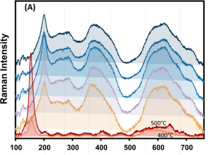
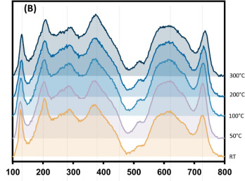
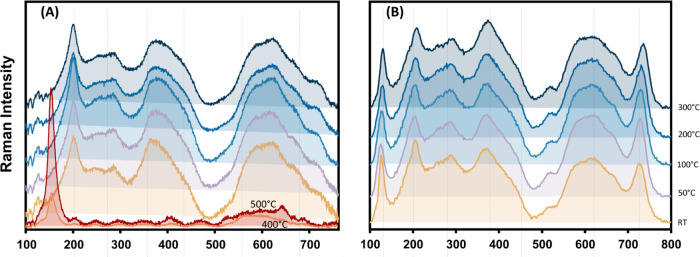
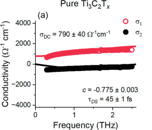
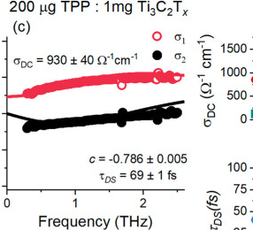
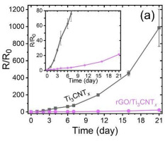
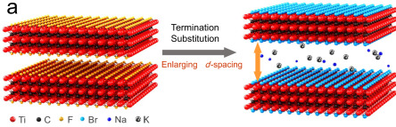
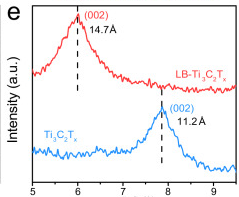

# Figure 6. Surface terminations, interlayer water, and MXene degradation

[Figure index](../README.md) · [Bibliography](../../references/bibliography.md)

## Caption

The panel labels below follow the manuscript. Available source crops are embedded under their corresponding labels.

## Panel guide

### (a) Thermally induced degradation

**(a1)** Temperature-dependent Raman series for the first MXene condition.

Source [[76]](../../references/bibliography.md#ref-76) (Figure 7, panel A). Cropped from the publisher figure. [CC BY 4.0](https://creativecommons.org/licenses/by/4.0/). [Full attribution and crop record](../panel-provenance.csv).

**(a2)** The second Raman series with the common temperature key [[76]](../../references/bibliography.md#ref-76).

Source [[76]](../../references/bibliography.md#ref-76) (Figure 7, panel B). Cropped from the publisher figure. [CC BY 4.0](https://creativecommons.org/licenses/by/4.0/). [Full attribution and crop record](../panel-provenance.csv).

**Shared axes for (a1–a2).** The adjacent source panels retain their common Raman/mode axes and temperature legend.

Source [[76]](../../references/bibliography.md#ref-76) (Figure 7, panels A–B). [CC BY 4.0](https://creativecommons.org/licenses/by/4.0/).

### (b) Confined water and thermal history

**(b1)** Resistivity during heating and cooling for different intercalants.

**(b2)** Interlayer spacing over the same thermal cycle.

**(b3)** Relationship between resistivity hysteresis and interlayer spacing [[19]](../../references/bibliography.md#ref-19).

### (c) Chemical stabilization of dispersions

**(c1)** Time series of the dispersions in the presence of different amino acids.

**(c2)** UV–visible spectra during ageing of the untreated MXene.

**(c3)** UV–visible spectra during ageing with serine [[17]](../../references/bibliography.md#ref-17).

### (d) Surface protection and charge transport

**(d1)** Terahertz conductivity spectrum of the untreated Ti₃C₂Tₓ film.

Source [[77]](../../references/bibliography.md#ref-77) (Figure 3, panel a). Cropped from the publisher figure. [CC BY 4.0](https://creativecommons.org/licenses/by/4.0/). [Full attribution and crop record](../panel-provenance.csv).

**(d2)** Terahertz conductivity spectrum after the stated tripolyphosphate addition [[77]](../../references/bibliography.md#ref-77).

Source [[77]](../../references/bibliography.md#ref-77) (Figure 3, panel c). Cropped from the publisher figure. [CC BY 4.0](https://creativecommons.org/licenses/by/4.0/). [Full attribution and crop record](../panel-provenance.csv).

**(d3)** Resistance history for bare MXene carbonitride and a graphene-protected film during ambient storage [[78]](../../references/bibliography.md#ref-78).

Source [[78]](../../references/bibliography.md#ref-78) (Figure 4, panel a). Cropped from the publisher figure. [CC BY 4.0](https://creativecommons.org/licenses/by/4.0/). [Full attribution and crop record](../panel-provenance.csv).

### (e) Halide exchange and gallery spacing

**(e1)** Model of termination exchange and interlayer expansion.

Source [[71]](../../references/bibliography.md#ref-71) (Fig. 1, panel a). Cropped from the publisher figure. [CC BY 4.0](https://creativecommons.org/licenses/by/4.0/). [Full attribution and crop record](../panel-provenance.csv).

**(e2)** Diffraction evidence for the corresponding spacing change [[71]](../../references/bibliography.md#ref-71).

Source [[71]](../../references/bibliography.md#ref-71) (Fig. 1, panel e). Cropped from the publisher figure. [CC BY 4.0](https://creativecommons.org/licenses/by/4.0/). [Full attribution and crop record](../panel-provenance.csv).

### (f) Titanium oxidation state during aqueous exposure

**(f1)** Ti L-edge spectra of the same MXene flakes before and after the reported water and acid exposures [[79]](../../references/bibliography.md#ref-79). The titanium-edge spectra probe oxidation-state changes over a controlled exposure history. The acid-treated response indicates that a chemical-state change and irreversible structural conversion can occur on different time scales.

## Source and reuse notes

Manuscript source references for the figure are [[17]](../../references/bibliography.md#ref-17), [[19]](../../references/bibliography.md#ref-19), [[71]](../../references/bibliography.md#ref-71), [[76]](../../references/bibliography.md#ref-76), [[77]](../../references/bibliography.md#ref-77), [[78]](../../references/bibliography.md#ref-78), [[79]](../../references/bibliography.md#ref-79).

The published crops carry source-specific Creative Commons terms. For the complete literature montage and any panel without an embedded crop, consult the cited source figure. The supplied manuscript credit language covers its figure references. The original montage files combine panels with different reuse terms.

[Attribution and crop metadata for the shared panels](../panel-provenance.csv).

Manuscript source credits

a1–a2 adapted from Ref. [[76]](../../references/bibliography.md#ref-76) Copyright 2024, American Chemical Society. b1–b3 reproduced with permission from Ref. [[19]](../../references/bibliography.md#ref-19). Copyright 2025, Springer Nature. c1–c3 reproduced with permission from Ref. [[17]](../../references/bibliography.md#ref-17). Copyright 2025, Royal Society of Chemistry. d1–d2 reproduced with permission from Ref. [[77]](../../references/bibliography.md#ref-77) Copyright 2026, American Chemical Society. d3 reproduced with permission from Ref. [[78]](../../references/bibliography.md#ref-78) Copyright 2023, American Chemical Society. e1–e2 reproduced with permission from Ref. [[71]](../../references/bibliography.md#ref-71) Copyright 2022, Springer Nature. f1 reproduced from Ref. [[79]](../../references/bibliography.md#ref-79) Copyright 2026, Royal Society of Chemistry.

## Scientific explanation

**Hydration and chemical ageing.** Water can facilitate access to galleries while also participating in degradation. Resistivity and conductivity probe electronic continuity, while Raman and X-ray absorption constrain chemical changes. The studies use different hydration states and treatments, so the figure supports mechanism-specific comparisons rather than a common ageing rate.
