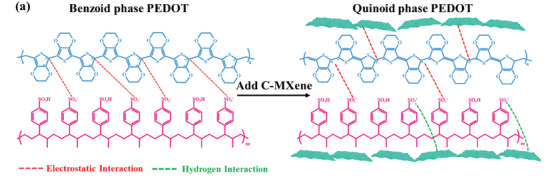
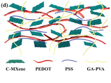
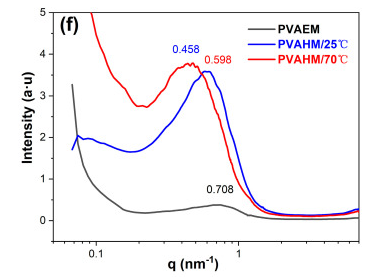
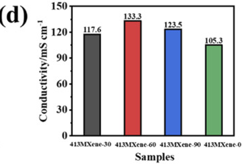
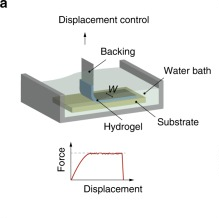
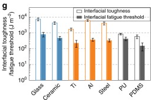
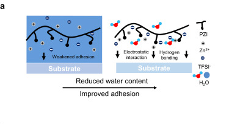
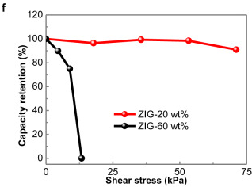

# Figure 7. Functional roles and chemical design of hydrogels in flexible energy devices

[Figure index](../README.md) · [Bibliography](../../references/bibliography.md)

## Caption

The panel labels below follow the manuscript. Available source crops are embedded under their corresponding labels.

## Panel guide

### (a) Conductive electrode host

**(a1)** Proposed PEDOT:PSS configuration before and after introduction of carboxylated MXene.

Source [[15]](../../references/bibliography.md#ref-15) (Figure 4, panel a). Cropped from the publisher figure. [CC BY 4.0](https://creativecommons.org/licenses/by/4.0/). [Full attribution and crop record](../panel-provenance.csv).

**(a2)** Schematic of MXene and polymer organization in the hybrid electrode hydrogel [[15]](../../references/bibliography.md#ref-15).

Source [[15]](../../references/bibliography.md#ref-15) (Figure 4, panel d). Cropped from the publisher figure. [CC BY 4.0](https://creativecommons.org/licenses/by/4.0/). [Full attribution and crop record](../panel-provenance.csv).

### (b) Polymer structure and ionic function

**(b1)** Small-angle scattering of PVA membranes prepared under the stated processing conditions, a network structure comparator [[103]](../../references/bibliography.md#ref-103).

Source [[103]](../../references/bibliography.md#ref-103) (Figure 3, panel f). Cropped from the publisher figure. [CC BY 4.0](https://creativecommons.org/licenses/by/4.0/). [Full attribution and crop record](../panel-provenance.csv).

**(b2)** Ionic conductivity of the PVA–acid gel across the reported V₄C₃Tₓ loadings [[83]](../../references/bibliography.md#ref-83).

Source [[83]](../../references/bibliography.md#ref-83) (FIGURE 6, panel D). Cropped from the publisher figure. [CC BY 4.0](https://creativecommons.org/licenses/by/4.0/). [Full attribution and crop record](../panel-provenance.csv).

### (c) Adhesive interface comparator

**(c1)** Displacement-controlled hydrogel peel geometry.

Source [[90]](../../references/bibliography.md#ref-90) (Fig. 2, panel a). Cropped from the publisher figure. [CC BY 4.0](https://creativecommons.org/licenses/by/4.0/). [Full attribution and crop record](../panel-provenance.csv).

**(c2)** Interfacial toughness and fatigue thresholds on multiple substrates [[90]](../../references/bibliography.md#ref-90).

Source [[90]](../../references/bibliography.md#ref-90) (Fig. 2, panel g). Cropped from the publisher figure. [CC BY 4.0](https://creativecommons.org/licenses/by/4.0/). [Full attribution and crop record](../panel-provenance.csv).

### (d) Electrolyte adhesion under shear

**(d1)** Proposed origin of enhanced adhesion in a lean-water gel electrolyte.

Source [[88]](../../references/bibliography.md#ref-88) (Fig. 6, panel a). Cropped from the publisher figure. [CC BY 4.0](https://creativecommons.org/licenses/by/4.0/). [Full attribution and crop record](../panel-provenance.csv).

**(d2)** Full-cell capacity retention versus imposed shear stress for two gel water contents [[88]](../../references/bibliography.md#ref-88).

Source [[88]](../../references/bibliography.md#ref-88) (Fig. 6, panel f). Cropped from the publisher figure. [CC BY 4.0](https://creativecommons.org/licenses/by/4.0/). [Full attribution and crop record](../panel-provenance.csv).

### (e) Load-bearing mineralized hydrogel comparator

**(e1)** Stress–strain response of the mineralized PVA and reference hydrogels.

**(e2)** Comparison of modulus, tensile strength, toughness and fracture energy across the reported PVA networks.

**(e3)** Fatigue crack-growth analysis used to estimate a fracture threshold for the mineralized gel [[104]](../../references/bibliography.md#ref-104).

### (f) Ion transport in a lean-water network

**(f1)** Proposed ion-transport pathway along the lubricating water-rich region of a lean-water zinc electrolyte [[88]](../../references/bibliography.md#ref-88). The mineralized PVA is a mechanical comparator. The lean-water pathway is a proposed electrolyte transport mechanism under a separate formulation and test protocol.

## Source and reuse notes

Manuscript source references for the figure are [[15]](../../references/bibliography.md#ref-15), [[83]](../../references/bibliography.md#ref-83), [[88]](../../references/bibliography.md#ref-88), [[90]](../../references/bibliography.md#ref-90), [[103]](../../references/bibliography.md#ref-103), [[104]](../../references/bibliography.md#ref-104).

The published crops carry source-specific Creative Commons terms. For the complete literature montage and any panel without an embedded crop, consult the cited source figure. The supplied manuscript credit language covers its figure references. The original montage files combine panels with different reuse terms.

[Attribution and crop metadata for the shared panels](../panel-provenance.csv).

Manuscript source credits

a1–a2 reproduced with permission from Ref. [[15]](../../references/bibliography.md#ref-15) Copyright 2024, Wiley-VCH GmbH. b1 reproduced with permission from Ref. [[103]](../../references/bibliography.md#ref-103) Copyright 2022, MDPI. b2 reproduced with permission from Ref. [[83]](../../references/bibliography.md#ref-83) Copyright 2024, Bin, Sheng, and Que. c1–c2 reproduced with permission from Ref. [[90]](../../references/bibliography.md#ref-90) Copyright 2020, Springer Nature. d1–d2, f1 reproduced with permission from Ref. [[88]](../../references/bibliography.md#ref-88) Copyright 2023, Springer Nature. e1–e3 reproduced with permission from Ref. [[104]](../../references/bibliography.md#ref-104). Copyright 2025, Springer Nature.

## Scientific explanation

**Gel function and network design.** The comparison separates a conducting gel electrode, an ion-conducting electrolyte, and a mechanically adhesive interface. A formulation can improve one of these functions while sacrificing another. Selection therefore depends on ion transport, electronic isolation, the relevant loading mode, and the water content in the assembled device.
