# Figure 8. MXene–hydrogel composite architectures and secondary-phase strategies

[Figure index](../README.md) · [Bibliography](../../references/bibliography.md)

## Caption

The panel labels below follow the manuscript. Available source crops are embedded under their corresponding labels.

## Panel guide

### (a) Freeze-structured MXene network

**(a1)** Cross-sectional microscopy of the ordered MXene hydrogel, as prepared for imaging.

[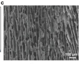](panels/panel-a1.png)

Source [[105]](../../references/bibliography.md#ref-105) (Figure 2, panel c). Cropped from the publisher figure. [CC BY 4.0](https://creativecommons.org/licenses/by/4.0/). [Full attribution and crop record](../panel-provenance.csv).

**(a2)** Top-view microscopy of the ordered network, as prepared for imaging [[105]](../../references/bibliography.md#ref-105).

[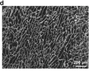](panels/panel-a2.png)

Source [[105]](../../references/bibliography.md#ref-105) (Figure 2, panel d). Cropped from the publisher figure. [CC BY 4.0](https://creativecommons.org/licenses/by/4.0/). [Full attribution and crop record](../panel-provenance.csv).

### (b) Holey MXene hydrogel

**(b1)** Raman response of starting MXene, intact hydrogel and holey hydrogel.

[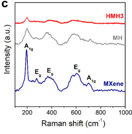](panels/panel-b1.png)

Source [[106]](../../references/bibliography.md#ref-106) (Figure 3, panel c). Cropped from the publisher figure. [CC BY 4.0](https://creativecommons.org/licenses/by/4.0/). [Full attribution and crop record](../panel-provenance.csv).

**(b2)** Current–voltage comparison of the intact and holey MXene networks [[106]](../../references/bibliography.md#ref-106).

[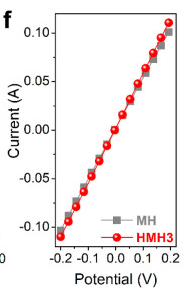](panels/panel-b2.png)

Source [[106]](../../references/bibliography.md#ref-106) (Figure 3, panel f). Cropped from the publisher figure. [CC BY 4.0](https://creativecommons.org/licenses/by/4.0/). [Full attribution and crop record](../panel-provenance.csv).

### (c) Conducting polymers and printed networks

**(c1)** Reported route using a cyclodextrin polymer to organize PANI and MXene in an electrode composite [[114]](../../references/bibliography.md#ref-114).

**(c2)** Representative printed geometries in the MXene composite process [[11]](../../references/bibliography.md#ref-11).

[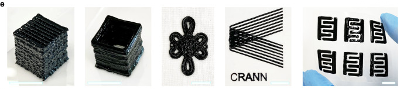](panels/panel-c2.png)

Source [[11]](../../references/bibliography.md#ref-11) (Fig. 2, panel e). Cropped from the publisher figure. [CC BY 4.0](https://creativecommons.org/licenses/by/4.0/). [Full attribution and crop record](../panel-provenance.csv).

### (d) Centrifugation-assisted assembly

**(d1)** Synthesis and gelation sequence using dispersed Ti₃C₂Tₓ and low-strength centrifugation.

[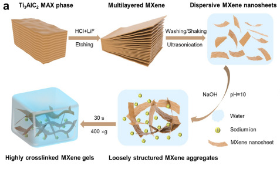](panels/panel-d1.png)

Source [[107]](../../references/bibliography.md#ref-107) (Fig. 1, panel a). Cropped from the publisher figure. [CC BY 4.0](https://creativecommons.org/licenses/by/4.0/). [Full attribution and crop record](../panel-provenance.csv).

**(d2)** Gelation map versus concentration and relative centrifugal force [[107]](../../references/bibliography.md#ref-107).

[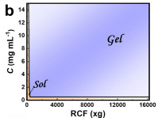](panels/panel-d2.png)

Source [[107]](../../references/bibliography.md#ref-107) (Fig. 1, panel b). Cropped from the publisher figure. [CC BY 4.0](https://creativecommons.org/licenses/by/4.0/). [Full attribution and crop record](../panel-provenance.csv).

### (e) Structural reinforcement and gallery control

**(e1)** Oriented MXene–hemicellulose films as an interface-reinforcement comparator [[115]](../../references/bibliography.md#ref-115).

[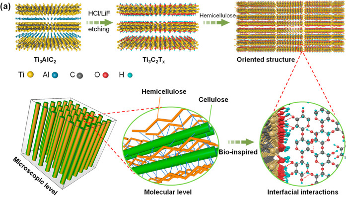](panels/panel-e1.png)

Source [[115]](../../references/bibliography.md#ref-115) (Figure 1, panel a). Cropped from the publisher figure. [CC BY 4.0](https://creativecommons.org/licenses/by/4.0/). [Full attribution and crop record](../panel-provenance.csv).

**(e2)** Lattice-resolved image of the K-treated and annealed MXene material [[116]](../../references/bibliography.md#ref-116).

[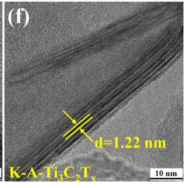](panels/panel-e2.png)

Source [[116]](../../references/bibliography.md#ref-116) (Figure 6, panel f). Cropped from the publisher figure. [CC BY 4.0](https://creativecommons.org/licenses/by/4.0/). [Full attribution and crop record](../panel-provenance.csv).

### (f) Carbon-dot assisted film porosity

**(f1)** Top-view microscopy of the porous MXene/carbon-dot film.

[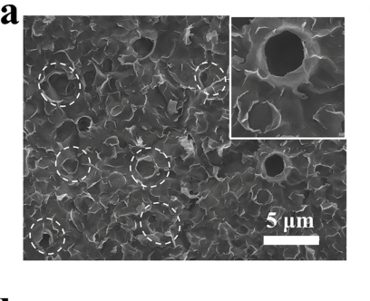](panels/panel-f1.png)

Source [[63]](../../references/bibliography.md#ref-63) (Fig. 2, panel a). Cropped from the publisher figure. [CC BY 4.0](https://creativecommons.org/licenses/by/4.0/). [Full attribution and crop record](../panel-provenance.csv).

**(f2)** Cross-section of the pure MXene comparison film [[63]](../../references/bibliography.md#ref-63).

[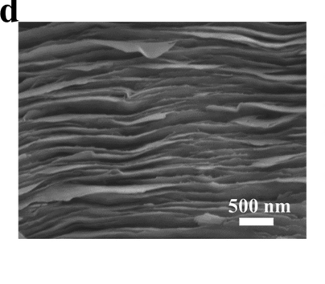](panels/panel-f2.png)

Source [[63]](../../references/bibliography.md#ref-63) (Fig. 2, panel d). Cropped from the publisher figure. [CC BY 4.0](https://creativecommons.org/licenses/by/4.0/). [Full attribution and crop record](../panel-provenance.csv).

### (g) Polymer network with and without MXene

**(g1)** Cross-section micrograph of the PVA/PAM/LiCl network without MXene.

**(g2)** Cross-section micrograph of the MXene-containing PVA/PAM/LiCl network.

**(g3)** Elemental maps across the MXene-containing composite section [[117]](../../references/bibliography.md#ref-117).

### (h) Interconnected gel morphology and mechanical response

**(h1)** MXene gel micrographs and morphology models across the reported assembly pH values. The paired composite images and pH series are architecture controls. The imaging state and mapping resolution constrain their interpretation for hydrated transport.

## Source and reuse notes

Manuscript source references for the figure are [[11]](../../references/bibliography.md#ref-11), [[63]](../../references/bibliography.md#ref-63), [[105]](../../references/bibliography.md#ref-105), [[106]](../../references/bibliography.md#ref-106), [[107]](../../references/bibliography.md#ref-107), [[114]](../../references/bibliography.md#ref-114), [[115]](../../references/bibliography.md#ref-115), [[116]](../../references/bibliography.md#ref-116), [[117]](../../references/bibliography.md#ref-117).

The published crops carry source-specific Creative Commons terms. For the complete literature montage and any panel without an embedded crop, consult the cited source figure. The supplied manuscript credit language covers its figure references. The original montage files combine panels with different reuse terms.

[Attribution and crop metadata for the shared panels](../panel-provenance.csv).

Manuscript source credits

a1–a2 reproduced with permission from Ref. [[105]](../../references/bibliography.md#ref-105) Copyright 2021, Wiley-VCH GmbH. b1–b2 reproduced with permission from Ref. [[106]](../../references/bibliography.md#ref-106) Copyright 2024, American Chemical Society. c1 reproduced with permission from Ref. [[114]](../../references/bibliography.md#ref-114). Copyright 2024, Royal Society of Chemistry. c2 reproduced with permission from Ref. [[11]](../../references/bibliography.md#ref-11) Copyright 2022, Springer Nature. d1–d2, h1 reproduced with permission from Ref. [[107]](../../references/bibliography.md#ref-107) Copyright 2024, Springer Nature. e1 reproduced with permission from Ref. [[115]](../../references/bibliography.md#ref-115) Copyright 2022, American Chemical Society. e2 reproduced with permission from Ref. [[116]](../../references/bibliography.md#ref-116) copyright 2022, MDPI. f1–f2 reproduced with permission from Ref. [[63]](../../references/bibliography.md#ref-63) Copyright 2023, Springer Nature. g1–g3 reproduced with permission from Ref. [[117]](../../references/bibliography.md#ref-117) Copyright 2025, MDPI.

## Scientific explanation

**Composite architectures.** Aligned pores, perforated sheets, conductive co-phases, and physical gelation offer different ways to improve access or continuity. Microscopy and framework-level conductivity can locate a plausible mechanism. Whether one architecture benefits a microcell requires matched wet thickness, loading, and electrode geometry.
