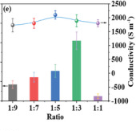
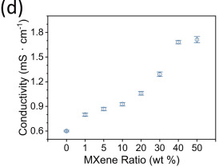
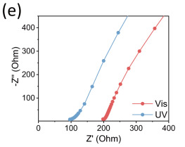
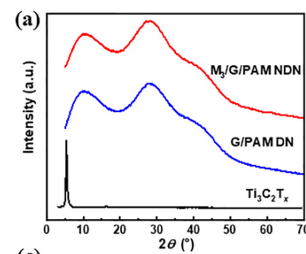
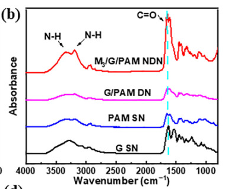
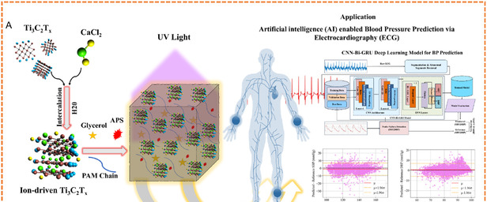
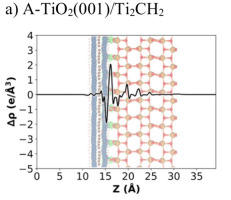
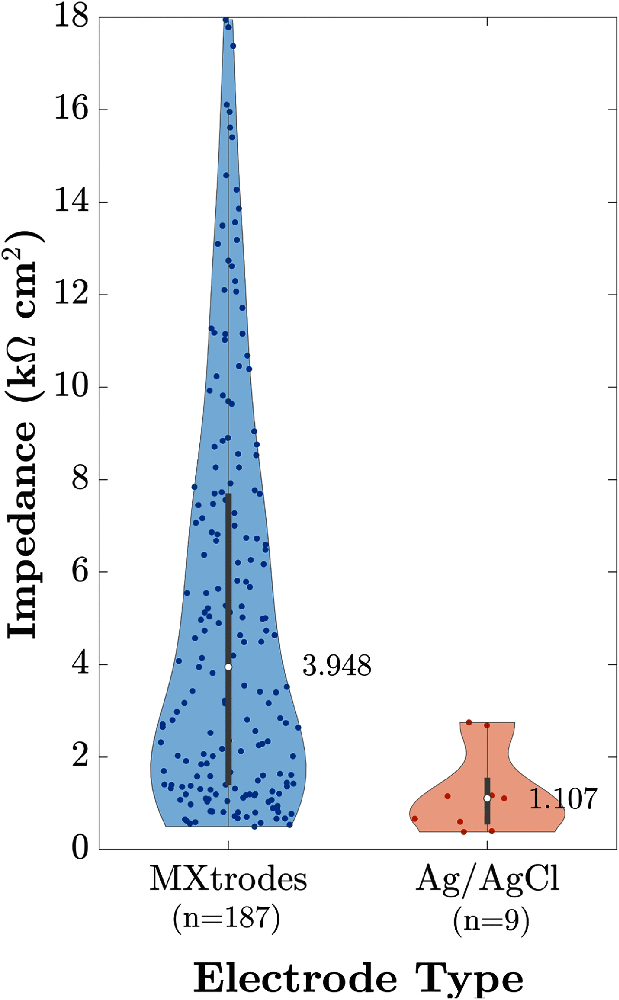
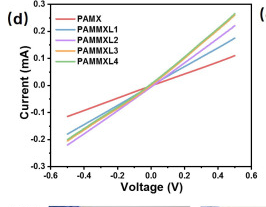

# Figure 9. Interfacial bonding and coupled ion–electron transport pathways

[Figure index](../README.md) · [Bibliography](../../references/bibliography.md)

## Caption

The panel labels below follow the manuscript. Available source crops are embedded under their corresponding labels.

## Panel guide

### (a) Conduction and stretch in gel electrodes

**(a1)** Stretchability and conductivity for the tested hybrid electrode compositions [[15]](../../references/bibliography.md#ref-15).

Source [[15]](../../references/bibliography.md#ref-15) (Figure 3, panel e). Cropped from the publisher figure. [CC BY 4.0](https://creativecommons.org/licenses/by/4.0/). [Full attribution and crop record](../panel-provenance.csv).

### (b) Supramolecular MXene bridging

**(b1)** Measured conductivity across MXene content in the host–guest gel.

Source [[20]](../../references/bibliography.md#ref-20) (Fig. 5, panel d). Cropped from the publisher figure. [CC BY 4.0](https://creativecommons.org/licenses/by/4.0/). [Full attribution and crop record](../panel-provenance.csv).

**(b2)** Impedance of the conductive gel after visible and ultraviolet illumination [[20]](../../references/bibliography.md#ref-20).

Source [[20]](../../references/bibliography.md#ref-20) (Fig. 5, panel e). Cropped from the publisher figure. [CC BY 4.0](https://creativecommons.org/licenses/by/4.0/). [Full attribution and crop record](../panel-provenance.csv).

### (c) Gelatin and PAM hybrid network

**(c1)** Diffraction of MXene and the unfilled and filled double-network gels.

Source [[97]](../../references/bibliography.md#ref-97) (Figure 4, panel a). Cropped from the publisher figure. [CC BY 4.0](https://creativecommons.org/licenses/by/4.0/). [Full attribution and crop record](../panel-provenance.csv).

**(c2)** Infrared spectra probing polymer interactions in the gel network [[97]](../../references/bibliography.md#ref-97).

Source [[97]](../../references/bibliography.md#ref-97) (Figure 4, panel b). Cropped from the publisher figure. [CC BY 4.0](https://creativecommons.org/licenses/by/4.0/). [Full attribution and crop record](../panel-provenance.csv).

### (d) Ion motion in confined MXene

**(d1)** Ion-transport cell built around an encapsulated lamellar MXene membrane.

**(d2)** Concentration-dependent conductance and inset current–voltage response of the channel array [[124]](../../references/bibliography.md#ref-124).

### (e) Bonding and calculated interface charge

**(e1)** Schematic of CaCl₂-assisted association in a MXene–PAM sensing material [[3]](../../references/bibliography.md#ref-3).

Source [[3]](../../references/bibliography.md#ref-3) (Figure 2, panel A). Cropped from the publisher figure. [CC BY 4.0](https://creativecommons.org/licenses/by/4.0/). [Full attribution and crop record](../panel-provenance.csv).

**(e2)** Calculated planar charge redistribution at the anatase TiO₂–Ti₂CH₂ model interface, a component-level comparator [[70]](../../references/bibliography.md#ref-70).

Source [[70]](../../references/bibliography.md#ref-70) (3, panel a). Cropped from the publisher figure. [CC BY 4.0](https://creativecommons.org/licenses/by/4.0/). [Full attribution and crop record](../panel-provenance.csv).

### (f) Contact impedance and conductance

**(f1)** Impedance distributions of dry MXene and gelled Ag/AgCl physiological electrodes, a contact-level comparator [[129]](../../references/bibliography.md#ref-129).

Source [[129]](../../references/bibliography.md#ref-129) (Figure 3., panel whole). Cropped from the publisher figure. [CC BY 4.0](https://creativecommons.org/licenses/by/4.0/). [Full attribution and crop record](../panel-provenance.csv).

**(f2)** Current–voltage characteristics of the compared hydrogel samples [[81]](../../references/bibliography.md#ref-81).

Source [[81]](../../references/bibliography.md#ref-81) (Figure 1, panel d). Cropped from the publisher figure. [CC BY 4.0](https://creativecommons.org/licenses/by/4.0/). [Full attribution and crop record](../panel-provenance.csv).

### (g) Salt-assisted coupling in a zwitterionic MXene gel

**(g1)** Storage and loss moduli during gelation for the tested salt formulations.

**(g2)** Infrared band comparisons for the polymer and salt-containing MXene formulations.

**(g3)** Proposed Li⁺ coordination and electrostatic contacts linking polymer, water and MXene [[49]](../../references/bibliography.md#ref-49).

### (h) Calculated gallery charge redistribution

**(h1)** Calculated interactions and charge-density redistribution for one of the ion-treated MXene gallery models. The rheology and spectra report network formation and chemical environment. The coordination and charge-density models supply testable mechanisms for subsequent transport experiments.

## Source and reuse notes

Manuscript source references for the figure are [[3]](../../references/bibliography.md#ref-3), [[15]](../../references/bibliography.md#ref-15), [[20]](../../references/bibliography.md#ref-20), [[49]](../../references/bibliography.md#ref-49), [[70]](../../references/bibliography.md#ref-70), [[81]](../../references/bibliography.md#ref-81), [[97]](../../references/bibliography.md#ref-97), [[124]](../../references/bibliography.md#ref-124), [[129]](../../references/bibliography.md#ref-129).

The published crops carry source-specific Creative Commons terms. For the complete literature montage and any panel without an embedded crop, consult the cited source figure. The supplied manuscript credit language covers its figure references. The original montage files combine panels with different reuse terms.

[Attribution and crop metadata for the shared panels](../panel-provenance.csv).

Manuscript source credits

a1 reproduced with permission from Ref. [[15]](../../references/bibliography.md#ref-15) Copyright 2024, Wiley-VCH GmbH. b1–b2 reproduced with permission from Ref. [[20]](../../references/bibliography.md#ref-20) Copyright 2024, Springer Nature. c1–c2 reproduced with permission from Ref. [[97]](../../references/bibliography.md#ref-97) Copyright 2022. d1–d2 reproduced with permission from Ref. [[124]](../../references/bibliography.md#ref-124) Copyright 2020, American Chemical Society. e1, h1 reproduced with permission from Ref. [[3]](../../references/bibliography.md#ref-3) Copyright 2025, Wiley-VCH GmbH. e2 reproduced with permission from Ref. [[70]](../../references/bibliography.md#ref-70) Copyright 2025, American Chemical Society. f1 reproduced with permission from Ref. [[129]](../../references/bibliography.md#ref-129) Copyright 2024, IOP Publishing. f2 reproduced with permission from Ref. [[81]](../../references/bibliography.md#ref-81) Copyright 2025, MDPI. g1–g3 reproduced with permission from Ref. [[49]](../../references/bibliography.md#ref-49) Copyright 2024, MDPI.

## Scientific explanation

**Interfacial coupling.** Gel composition affects sheet contact and deformation as well as solvated-ion motion. The independent scales of modulus, ionic migration, surface charge, and contact impedance clarify why total impedance alone cannot identify the limiting pathway. The physiological electrode examples inform interface design under their specified measurement conditions.
