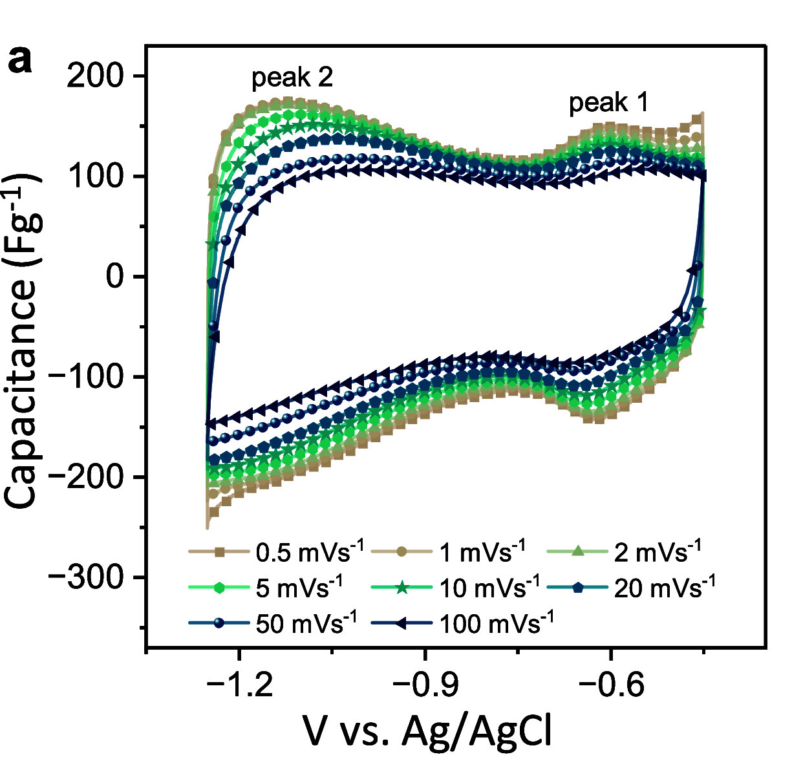
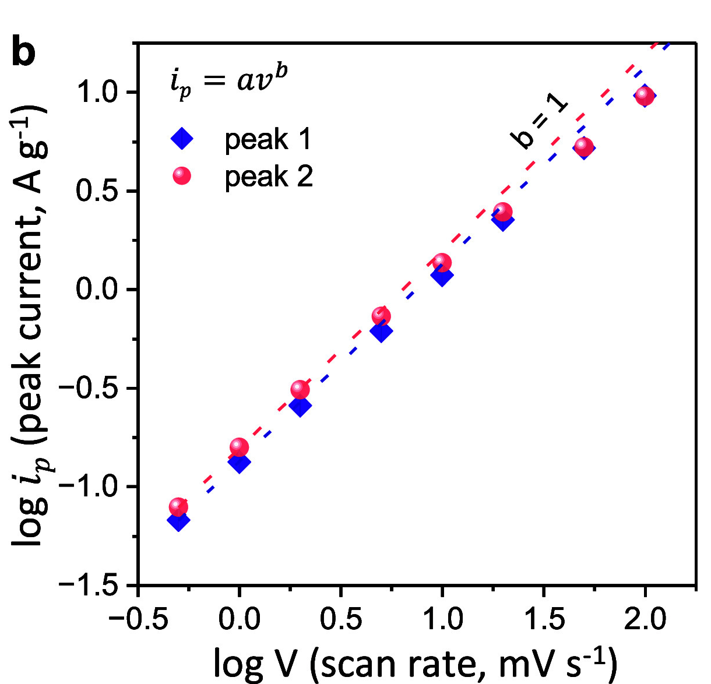
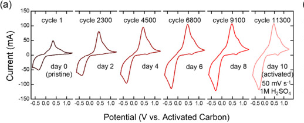
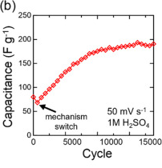
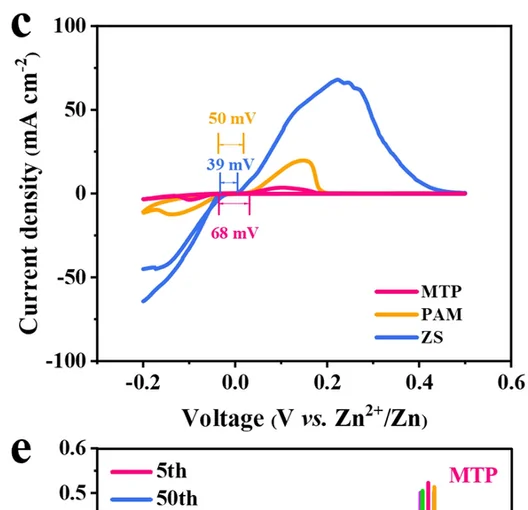
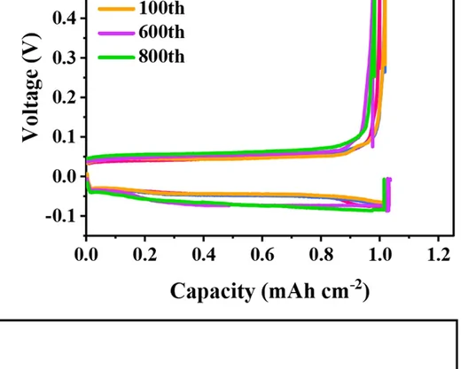
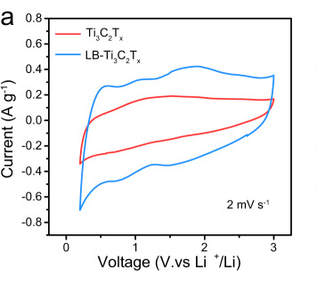
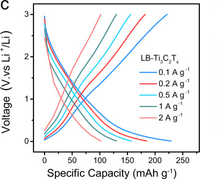

# Figure 10. Charge-storage mechanisms: EDLC, surface redox, intercalation, and battery reactions

[Figure index](../README.md) · [Bibliography](../../references/bibliography.md)

## Caption

The panel labels below follow the manuscript. Available source crops are embedded under their corresponding labels.

## Panel guide

### (a) Pseudocapacitive guest and host response

**(a1)** Potential-dependent capacitance curves of Cu-intercalated Ti₃C₂Tₓ across scan rates.

Source [[31]](../../references/bibliography.md#ref-31) (Figure 3, panel a). Cropped from the publisher figure. [CC BY 4.0](https://creativecommons.org/licenses/by/4.0/). [Full attribution and crop record](../panel-provenance.csv).

**(a2)** Rate scaling of two electrochemical peaks [[31]](../../references/bibliography.md#ref-31).

Source [[31]](../../references/bibliography.md#ref-31) (Figure 3, panel b). Cropped from the publisher figure. [CC BY 4.0](https://creativecommons.org/licenses/by/4.0/). [Full attribution and crop record](../panel-provenance.csv).

### (b) Electrochemical activation in acid

**(b1)** Evolution of Ti₄N₃Tₓ cyclic voltammograms during acid-electrolyte conditioning.

Source [[134]](../../references/bibliography.md#ref-134) (Figure 3, panel a). Cropped from the publisher figure. [CC BY 4.0](https://creativecommons.org/licenses/by/4.0/). [Full attribution and crop record](../panel-provenance.csv).

**(b2)** Corresponding capacitance and the source's indicated transition [[134]](../../references/bibliography.md#ref-134).

Source [[134]](../../references/bibliography.md#ref-134) (Figure 3, panel b). Cropped from the publisher figure. [CC BY 4.0](https://creativecommons.org/licenses/by/4.0/). [Full attribution and crop record](../panel-provenance.csv).

### (c) Mixed response in an organic electrolyte

**(c1)** Two-electrode comparison of the layered carbide materials by cyclic voltammetry.

**(c2)** Terminal charge and discharge in the same electrolyte [[65]](../../references/bibliography.md#ref-65).

### (d) Zinc deposition and removal

**(d1)** Voltammetry of Zn//Cu cells with different electrolytes .

Source [[127]](../../references/bibliography.md#ref-127) (Fig. 4, panel c). Cropped from the publisher figure. [CC BY 4.0](https://creativecommons.org/licenses/by/4.0/). [Full attribution and crop record](../panel-provenance.csv).

**(d2)** Voltage and capacity profiles of Zn//gel//Cu under the reported cycling conditions [[127]](../../references/bibliography.md#ref-127).

Source [[127]](../../references/bibliography.md#ref-127) (Fig. 4, panel e). Cropped from the publisher figure. [CC BY 4.0](https://creativecommons.org/licenses/by/4.0/). [Full attribution and crop record](../panel-provenance.csv).

### (e) Lithium uptake as a reaction comparator

**(e1)** Potential response of treated and untreated Ti₃C₂Tₓ in the reported Li-referenced test.

Source [[71]](../../references/bibliography.md#ref-71) (Fig. 4, panel a). Cropped from the publisher figure. [CC BY 4.0](https://creativecommons.org/licenses/by/4.0/). [Full attribution and crop record](../panel-provenance.csv).

**(e2)** Galvanostatic capacity profiles for the treated material [[71]](../../references/bibliography.md#ref-71).

Source [[71]](../../references/bibliography.md#ref-71) (Fig. 4, panel c). Cropped from the publisher figure. [CC BY 4.0](https://creativecommons.org/licenses/by/4.0/). [Full attribution and crop record](../panel-provenance.csv).

### (f) Electric double-layer comparator in carbon pores

**(f1)** Coupled voltammetry and electrochemical quartz-crystal microbalance response of activated carbon in the sodium electrolyte.

**(f2)** Mass change versus charge used to distinguish ion exchange and adsorption regions.

**(f3)** Potential-dependent sodium NMR response in the activated-carbon experiment [[131]](../../references/bibliography.md#ref-131).

### (g) Single-monolayer pseudocapacitive response

**(g1)** Local voltammograms of a monolayer Ti₃C₂Tₓ flake and the bare carbon support.

**(g2)** Areal capacitance distributions for bare carbon, multilayer material and monolayer Ti₃C₂Tₓ [[132]](../../references/bibliography.md#ref-132).

### (h) Chemical contrast during proton uptake

**(h1)** Cyclic voltammogram used to select states for Ti-edge chemical imaging in acid.

**(h2)** Ti L-edge absorption spectra at the reported open-circuit and negatively biased states [[79]](../../references/bibliography.md#ref-79). The activated-carbon data are a mechanistic comparator in a sodium electrolyte. The monolayer and titanium-edge experiments independently constrain charge-storage assignments for MXene in the reported acidic environments.

## Source and reuse notes

Manuscript source references for the figure are [[31]](../../references/bibliography.md#ref-31), [[65]](../../references/bibliography.md#ref-65), [[71]](../../references/bibliography.md#ref-71), [[79]](../../references/bibliography.md#ref-79), [[127]](../../references/bibliography.md#ref-127), [[131]](../../references/bibliography.md#ref-131), [[132]](../../references/bibliography.md#ref-132), [[134]](../../references/bibliography.md#ref-134).

The published crops carry source-specific Creative Commons terms. For the complete literature montage and any panel without an embedded crop, consult the cited source figure. The supplied manuscript credit language covers its figure references. The original montage files combine panels with different reuse terms.

[Attribution and crop metadata for the shared panels](../panel-provenance.csv).

Manuscript source credits

a1–a2 reproduced with permission from Ref. [[31]](../../references/bibliography.md#ref-31) Copyright 2024, American Chemical Society. b1–b2 reproduced with permission from Ref. [[134]](../../references/bibliography.md#ref-134) Copyright 2024, American Chemical Society. c1–c2 reproduced with permission from Ref. [[65]](../../references/bibliography.md#ref-65). Copyright 2022, American Chemical Society. d1–d2 reproduced with permission from Ref. [[127]](../../references/bibliography.md#ref-127) Copyright 2026, Springer Nature. e1–e2 reproduced with permission from Ref. [[71]](../../references/bibliography.md#ref-71) Copyright 2022, Springer Nature. f1–f3 reproduced with permission from Ref. [[131]](../../references/bibliography.md#ref-131). Copyright 2026, Springer Nature. g1–g2 reproduced with permission from Ref. [[132]](../../references/bibliography.md#ref-132) Copyright 2023, Springer Nature. h1–h2 reproduced with permission from Ref. [[79]](../../references/bibliography.md#ref-79) Copyright 2026, Royal Society of Chemistry.

## Scientific explanation

**Mechanisms and diagnostic evidence.** Potential-resolved spectroscopy and layer-sensitive measurements provide complementary tests of guest and host redox, surface processes, and gallery access. Carbon adsorption and zinc deposition are mechanism comparators. These measurements were made in different electrochemical environments, and their assignments should be tested independently in a working gel cell.
