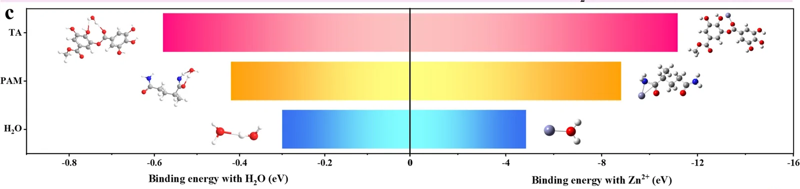
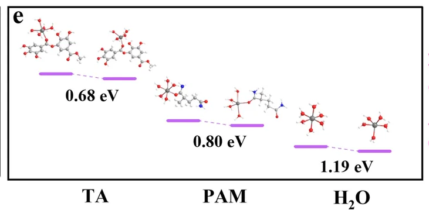
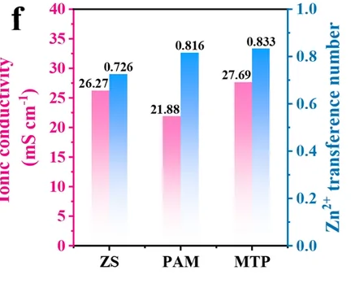

# Figure 11. Hydrogel-electrolyte solvation and ion-transport regulation

[Figure index](../README.md) · [Bibliography](../../references/bibliography.md)

## Caption

The panel labels below follow the manuscript. Available source crops are embedded under their corresponding labels.

## Panel guide

### (a) Tannic acid and MXene filled gel

**(a1)** Calculated binding of water and Zn²⁺ with the selected electrolyte molecules and polymer.

Source [[127]](../../references/bibliography.md#ref-127) (Fig. 3, panel c). Cropped from the publisher figure. [CC BY 4.0](https://creativecommons.org/licenses/by/4.0/). [Full attribution and crop record](../panel-provenance.csv).

**(a2)** Calculated barriers for Zn²⁺ desolvation in the three molecular environments.

Source [[127]](../../references/bibliography.md#ref-127) (Fig. 3, panel e). Cropped from the publisher figure. [CC BY 4.0](https://creativecommons.org/licenses/by/4.0/). [Full attribution and crop record](../panel-provenance.csv).

**(a3)** Measured ionic conductivity and reported Zn²⁺ transference numbers for solution and gel formulations [[127]](../../references/bibliography.md#ref-127).

Source [[127]](../../references/bibliography.md#ref-127) (Fig. 3, panel f). Cropped from the publisher figure. [CC BY 4.0](https://creativecommons.org/licenses/by/4.0/). [Full attribution and crop record](../panel-provenance.csv).

### (b) Anisotropic cellulose gel

**(b1)** Polarization and impedance used to estimate Zn²⁺ transference in the anisotropic gel.

**(b2)** Symmetric-cell plating and stripping at the reported current and areal capacity.

**(b3)** In situ X-ray diffraction during zinc plating with the anisotropic gel [[86]](../../references/bibliography.md#ref-86).

### (c) Ligand control of zinc solvation

**(c1)** Raman response of the gel electrolyte across maltose content.

**(c2)** Chemical-shift comparison for the selected electrolyte states.

**(c3)** Simulated Zn²⁺ mean-square displacement in crowded gel and liquid environments [[87]](../../references/bibliography.md#ref-87).

### (d) Anisotropic PVA electrolyte

**(d1)** Proposed Zn transport and deposition in liquid and anisotropic gel.

**(d2)** Raman deconvolution for triflate-containing electrolyte environments.

**(d3)** Zn²⁺ transference numbers in liquid, isotropic and anisotropic gel [[89]](../../references/bibliography.md#ref-89).

### (e) Selective zinc pathways in a polymer electrolyte

**(e1)** Simulated Zn²⁺–water radial distribution and coordination numbers in the polymer electrolyte.

**(e2)** Molecular-dynamics snapshots tracking zinc-ion motion through the quasi-solid electrolyte [[137]](../../references/bibliography.md#ref-137).

### (f) Aramid network effects on electrolyte transport

**(f1)** Ionic conductivity comparison from current–voltage slopes of the PVA and aramid-reinforced PVA gels.

**(f2)** Scattering measurements of the PVA and aramid-reinforced PVA hydrogel structures [[138]](../../references/bibliography.md#ref-138). Simulated coordination, gel scattering and conductivity describe distinct length scales. The reported conductivity comparison is specific to the test formulation and does not by itself resolve cation transference.

## Source and reuse notes

Manuscript source references for the figure are [[86]](../../references/bibliography.md#ref-86), [[87]](../../references/bibliography.md#ref-87), [[89]](../../references/bibliography.md#ref-89), [[127]](../../references/bibliography.md#ref-127), [[137]](../../references/bibliography.md#ref-137), [[138]](../../references/bibliography.md#ref-138).

The published crops carry source-specific Creative Commons terms. For the complete literature montage and any panel without an embedded crop, consult the cited source figure. The supplied manuscript credit language covers its figure references. The original montage files combine panels with different reuse terms.

[Attribution and crop metadata for the shared panels](../panel-provenance.csv).

Manuscript source credits

a1–a3 reproduced with permission from Ref. [[127]](../../references/bibliography.md#ref-127)  2026, Springer Nature. b1–b3 reproduced with permission from Ref. [[86]](../../references/bibliography.md#ref-86). Copyright 2024, National Academy of Sciences. c1–c3 reproduced with permission from Ref. [[87]](../../references/bibliography.md#ref-87). Copyright 2025, Springer Nature. d1–d3 reproduced with permission from Ref. [[89]](../../references/bibliography.md#ref-89). Copyright 2025, Wiley-VCH GmbH. e1–e2 reproduced with permission from Ref. [[137]](../../references/bibliography.md#ref-137). Copyright 2025, Springer Nature. f1–f2 reproduced with permission from Ref. [[138]](../../references/bibliography.md#ref-138). Copyright 2026, Springer Nature.

## Scientific explanation

**Electrolyte design.** Polymer alignment, accessible water, ion coordination, and ion-selective pathways can change the ionic environment encountered by a zinc electrode. Calculated binding and radial distribution functions address molecular hypotheses. Measured conductivity, transference indicators, and plating morphology address transport and deposition under the stated conditions.
