# Figure 12. Micro-supercapacitor configurations and hydrogel-enabled electrode/electrolyte design

[Figure index](../README.md) · [Bibliography](../../references/bibliography.md)

## Caption

The panel labels below follow the manuscript. Available source crops are embedded under their corresponding labels.

## Panel guide

### (a) In-plane gel placement

**(a1)** Sequence of electrode patterning, electrolyte casting and elastomer sealing.

[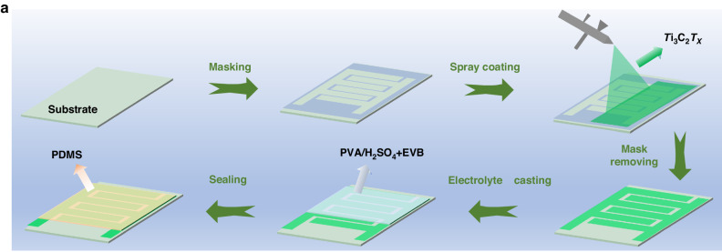](panels/panel-a1.png)

Source [[146]](../../references/bibliography.md#ref-146) (Fig. 1, panel a). Cropped from the publisher figure. [CC BY 4.0](https://creativecommons.org/licenses/by/4.0/). [Full attribution and crop record](../panel-provenance.csv).

**(a2)** Illustration of ion transfer in the in-plane electrochromic cell [[146]](../../references/bibliography.md#ref-146).

[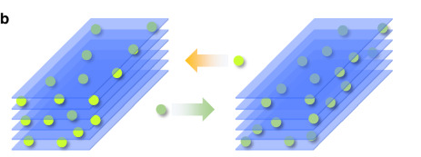](panels/panel-a2.png)

Source [[146]](../../references/bibliography.md#ref-146) (Fig. 1, panel b). Cropped from the publisher figure. [CC BY 4.0](https://creativecommons.org/licenses/by/4.0/). [Full attribution and crop record](../panel-provenance.csv).

### (b) Electrolyte and rate dependence

**(b1)** Galvanostatic cell profiles at the higher current densities.

[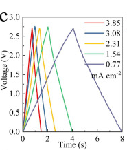](panels/panel-b1.png)

Source [[8]](../../references/bibliography.md#ref-8) (Fig. 3, panel c). Cropped from the publisher figure. [CC BY 4.0](https://creativecommons.org/licenses/by/4.0/). [Full attribution and crop record](../panel-provenance.csv).

**(b2)** Voltage–time response for the selected electrolyte alternatives [[8]](../../references/bibliography.md#ref-8).

[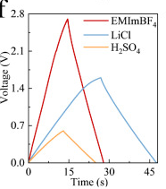](panels/panel-b2.png)

Source [[8]](../../references/bibliography.md#ref-8) (Fig. 3, panel f). Cropped from the publisher figure. [CC BY 4.0](https://creativecommons.org/licenses/by/4.0/). [Full attribution and crop record](../panel-provenance.csv).

### (c) Aerosol-printed gel cell

**(c1)** Charge and discharge of the printed cell in the PVA–acid gel.

[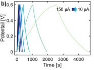](panels/panel-c1.png)

Source [[147]](../../references/bibliography.md#ref-147) (Figure 5, panel b). Cropped from the publisher figure. [CC BY 4.0](https://creativecommons.org/licenses/by/4.0/). [Full attribution and crop record](../panel-provenance.csv).

**(c2)** Voltammograms under the reported bending states [[147]](../../references/bibliography.md#ref-147).

[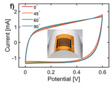](panels/panel-c2.png)

Source [[147]](../../references/bibliography.md#ref-147) (Figure 5, panel f). Cropped from the publisher figure. [CC BY 4.0](https://creativecommons.org/licenses/by/4.0/). [Full attribution and crop record](../panel-provenance.csv).

### (d) Paper MSC and yarn-cell comparator

**(d1)** Photograph identifying the device and contact regions of the paper-based MSC [[148]](../../references/bibliography.md#ref-148).

[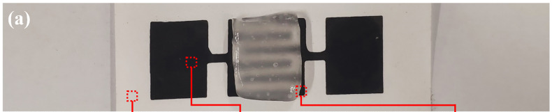](panels/panel-d1.png)

Source [[148]](../../references/bibliography.md#ref-148) (Figure 6, panel a). Cropped from the publisher figure. [CC BY 4.0](https://creativecommons.org/licenses/by/4.0/). [Full attribution and crop record](../panel-provenance.csv).

**(d2)** Carbon-yarn supercapacitor with a cellulose hydrogel electrolyte, an external geometry comparator [[5]](../../references/bibliography.md#ref-5).

### (e) Printed hydrogel electrode MSC

**(e1)** Galvanostatic response of the 4D-printed hydrogel microcell.

[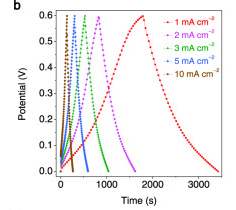](panels/panel-e1.png)

Source [[11]](../../references/bibliography.md#ref-11) (Fig. 4, panel b). Cropped from the publisher figure. [CC BY 4.0](https://creativecommons.org/licenses/by/4.0/). [Full attribution and crop record](../panel-provenance.csv).

**(e2)** Low-temperature comparison of full-cell voltammograms [[11]](../../references/bibliography.md#ref-11).

[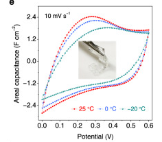](panels/panel-e2.png)

Source [[11]](../../references/bibliography.md#ref-11) (Fig. 4, panel e). Cropped from the publisher figure. [CC BY 4.0](https://creativecommons.org/licenses/by/4.0/). [Full attribution and crop record](../panel-provenance.csv).

### (f) Direct printing comparator

**(f1)** Galvanostatic response of the directly printed MXene MSC.

[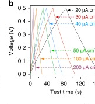](panels/panel-f1.png)

Source [[149]](../../references/bibliography.md#ref-149) (Fig. 5, panel b). Cropped from the publisher figure. [CC BY 4.0](https://creativecommons.org/licenses/by/4.0/). [Full attribution and crop record](../panel-provenance.csv).

**(f2)** Voltammograms of the printed MSC under the stated bending conditions [[149]](../../references/bibliography.md#ref-149).

[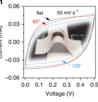](panels/panel-f2.png)

Source [[149]](../../references/bibliography.md#ref-149) (Fig. 5, panel h). Cropped from the publisher figure. [CC BY 4.0](https://creativecommons.org/licenses/by/4.0/). [Full attribution and crop record](../panel-provenance.csv).

### (g) Gel sandwich and bending of an asymmetric cell

**(g1)** Layer sequence and demonstration of the flexible Ti₃C₂Tₓ–conjugated-polyelectrolyte gel pseudocapacitor.

**(g2)** Two-electrode voltammograms of the solid-state cell at the indicated bending angles [[140]](../../references/bibliography.md#ref-140). The bending series is a two-electrode response of the sandwich configuration. The gel thickness, current path and footprint differ from those in the planar microcells.

## Source and reuse notes

Manuscript source references for the figure are [[5]](../../references/bibliography.md#ref-5), [[8]](../../references/bibliography.md#ref-8), [[11]](../../references/bibliography.md#ref-11), [[140]](../../references/bibliography.md#ref-140), [[146]](../../references/bibliography.md#ref-146), [[147]](../../references/bibliography.md#ref-147), [[148]](../../references/bibliography.md#ref-148), [[149]](../../references/bibliography.md#ref-149).

The published crops carry source-specific Creative Commons terms. For the complete literature montage and any panel without an embedded crop, consult the cited source figure. The supplied manuscript credit language covers its figure references. The original montage files combine panels with different reuse terms.

[Attribution and crop metadata for the shared panels](../panel-provenance.csv).

Manuscript source credits

a1–a2 reproduced with permission from Ref. [[146]](../../references/bibliography.md#ref-146) Copyright 2024, Springer Nature. b1–b2 reproduced with permission from Ref. [[8]](../../references/bibliography.md#ref-8) Copyright 2024, Springer Nature. c1–c2 reproduced with permission from Ref. [[147]](../../references/bibliography.md#ref-147) Copyright 2025, Wiley-VCH GmbH. d1 reproduced with permission from Ref. [[148]](../../references/bibliography.md#ref-148) Copyright 2021, MDPI. d2 reproduced with permission from Ref. [[5]](../../references/bibliography.md#ref-5). Copyright 2022, American Chemical Society. e1–e2 reproduced with permission from Ref. [[11]](../../references/bibliography.md#ref-11) Copyright 2022, Springer Nature. f1–f2 reproduced with permission from Ref. [[149]](../../references/bibliography.md#ref-149) Copyright 2019, Springer Nature. g1–g2 reproduced with permission from Ref. [[140]](../../references/bibliography.md#ref-140). Copyright 2025, Springer Nature.

## Scientific explanation

**Microsupercapacitor layout.** In-plane gap, active loading, aqueous gel placement, and the current-collector geometry constrain the occupied footprint and accessible charge. Rate-response curves can be compared directly only where the cell configuration, normalization, cutoff, and discharge time are comparable.
