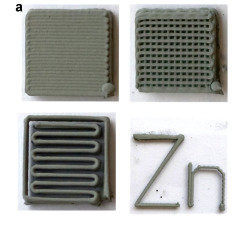
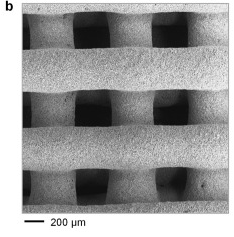
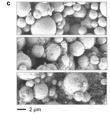
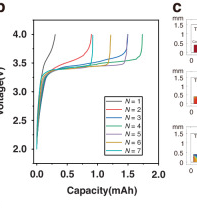
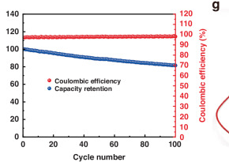
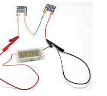
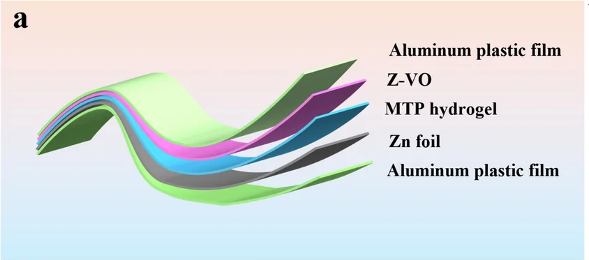
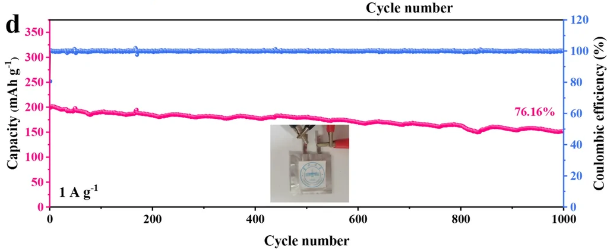

# Figure 13. MXene-containing microbattery architectures and battery-type reactions

[Figure index](../README.md) · [Bibliography](../../references/bibliography.md)

## Caption

The panel labels below follow the manuscript. Available source crops are embedded under their corresponding labels.

## Panel guide

### (a) Printed Zn microbattery comparator

**(a1)** Printed zinc-based features, including the interdigitated pattern.

Source [[22]](../../references/bibliography.md#ref-22) (Figure 1, panel a). Cropped from the publisher figure. [CC BY 4.0](https://creativecommons.org/licenses/by/4.0/). [Full attribution and crop record](../panel-provenance.csv).

**(a2)** Cross-sectional scale and continuity of the printed zinc–carbon electrode.

Source [[22]](../../references/bibliography.md#ref-22) (Figure 1, panel b). Cropped from the publisher figure. [CC BY 4.0](https://creativecommons.org/licenses/by/4.0/). [Full attribution and crop record](../panel-provenance.csv).

**(a3)** Micrographs of the zinc particles and carbon-containing formulations [[22]](../../references/bibliography.md#ref-22).

Source [[22]](../../references/bibliography.md#ref-22) (Figure 1, panel c). Cropped from the publisher figure. [CC BY 4.0](https://creativecommons.org/licenses/by/4.0/). [Full attribution and crop record](../panel-provenance.csv).

### (b) MXene lithium microbattery

**(b1)** Simulated full-cell capacity versus interdigitated finger-pair count.

Source [[151]](../../references/bibliography.md#ref-151) (Fig. 8, panel b). Cropped from the publisher figure. [CC BY 4.0](https://creativecommons.org/licenses/by/4.0/). [Full attribution and crop record](../panel-provenance.csv).

**(b2)** Measured capacity retention and Coulombic efficiency of the microcell.

Source [[151]](../../references/bibliography.md#ref-151) (Fig. 8, panel f). Cropped from the publisher figure. [CC BY 4.0](https://creativecommons.org/licenses/by/4.0/). [Full attribution and crop record](../panel-provenance.csv).

**(b3)** Two connected microcells shown supplying the demonstration load [[151]](../../references/bibliography.md#ref-151).

Source [[151]](../../references/bibliography.md#ref-151) (Fig. 8, panel g). Cropped from the publisher figure. [CC BY 4.0](https://creativecommons.org/licenses/by/4.0/). [Full attribution and crop record](../panel-provenance.csv).

### (c) Zinc gel fiber-cell comparator

**(c1)** Carbon-supported MnO₂ positive electrode for the rechargeable zinc fiber cell.

**(c2)** Voltage and capacity profiles before and after the reported cycling interval [[6]](../../references/bibliography.md#ref-6).

### (d) MXene-filled gel in a pouch cell

**(d1)** Flexible pouch cell stack with the MXene-containing gel electrolyte.

Source [[127]](../../references/bibliography.md#ref-127) (Fig. 7, panel a). Cropped from the publisher figure. [CC BY 4.0](https://creativecommons.org/licenses/by/4.0/). [Full attribution and crop record](../panel-provenance.csv).

**(d2)** Capacity and Coulombic efficiency over the pouch-cell cycling protocol [[127]](../../references/bibliography.md#ref-127).

Source [[127]](../../references/bibliography.md#ref-127) (Fig. 7, panel d). Cropped from the publisher figure. [CC BY 4.0](https://creativecommons.org/licenses/by/4.0/). [Full attribution and crop record](../panel-provenance.csv).

### (e) Self-healing Zn gel full-cell comparator

**(e1)** Reported Zn full-cell architecture with the hydrated separator between battery electrodes.

**(e2)** Microscopy of the hybrid hydrogel electrolyte [[152]](../../references/bibliography.md#ref-152).

### (f) Planar gel-electrolyte zinc conversion microbattery

**(f1)** Planar interdigitated fabrication sequence for the Zn∥Bi₂O₃@Ag₂O microbattery.

**(f2)** Interdigitated electrode geometry and active phases of the dual-conversion zinc microcell.

**(f3)** Ex situ impedance of the conversion microbattery at defined charge and discharge states [[13]](../../references/bibliography.md#ref-13).

### (g) Co-spun aramid fiber battery comparator

**(g1)** Triple-lumen wet-spinning route and cross-section of the aramid-reinforced zinc-ion fiber battery [[138]](../../references/bibliography.md#ref-138). The planar dual-conversion device and aramid fiber cell are non-MXene comparators. Their distinct chemistries and load paths help separate architectural effects from any contribution of MXene.

## Source and reuse notes

Manuscript source references for the figure are [[6]](../../references/bibliography.md#ref-6), [[13]](../../references/bibliography.md#ref-13), [[22]](../../references/bibliography.md#ref-22), [[127]](../../references/bibliography.md#ref-127), [[138]](../../references/bibliography.md#ref-138), [[151]](../../references/bibliography.md#ref-151), [[152]](../../references/bibliography.md#ref-152).

The published crops carry source-specific Creative Commons terms. For the complete literature montage and any panel without an embedded crop, consult the cited source figure. The supplied manuscript credit language covers its figure references. The original montage files combine panels with different reuse terms.

[Attribution and crop metadata for the shared panels](../panel-provenance.csv).

Manuscript source credits

a1–a3 reproduced with permission from Ref. [[22]](../../references/bibliography.md#ref-22) Copyright 2025, American Chemical Society. b1–b3 reproduced with permission from Ref. [[151]](../../references/bibliography.md#ref-151) Copyright 2026, Springer Nature. c1–c2 reproduced with permission from Ref. [[6]](../../references/bibliography.md#ref-6). Copyright 2021, AAAS. d1–d2 reproduced with permission from Ref. [[127]](../../references/bibliography.md#ref-127) Copyright 2026, Springer Nature. e1–e2 reproduced with permission from Ref. [[152]](../../references/bibliography.md#ref-152). Copyright 2024, Royal Society of Chemistry. f1–f3 reproduced with permission from Ref. [[13]](../../references/bibliography.md#ref-13). Copyright 2026, Springer Nature. g1 reproduced with permission from Ref. [[138]](../../references/bibliography.md#ref-138). Copyright 2026, Springer Nature.

## Scientific explanation

**Battery microcells and comparators.** Deposited zinc, insertion electrodes, and conversion microcells impose different inventory, balance, and protection requirements. The panels span microfabricated complete cells, pouch and fiber architectures, and non-MXene benchmarks. Use each demonstration for the material role and device scale it actually examines.
