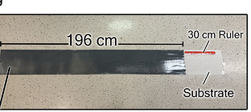
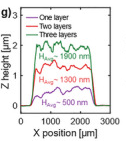
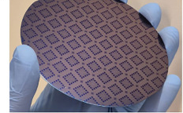
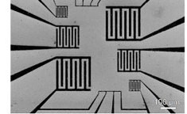
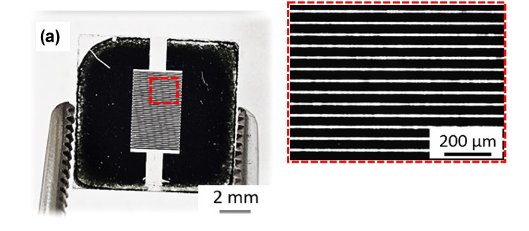
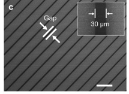
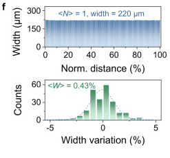
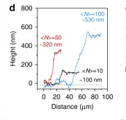
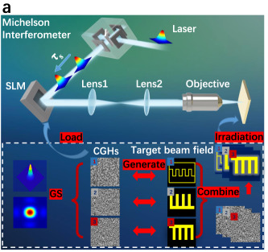
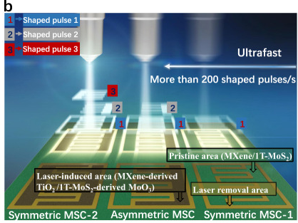

# Figure 14. Microfabrication and patterning methods for flexible MXene–hydrogel devices

[Figure index](../README.md) · [Bibliography](../../references/bibliography.md)

## Caption

The panel labels below follow the manuscript. Available source crops are embedded under their corresponding labels.

## Panel guide

### (a) Feature geometry and production scale

**(a1)** Roll-to-roll MXene composite membrane as a continuous manufacturing comparator [[164]](../../references/bibliography.md#ref-164).

Source [[164]](../../references/bibliography.md#ref-164) (FIGURE 1, panel g). Cropped from the publisher figure. [CC BY 4.0](https://creativecommons.org/licenses/by/4.0/). [Full attribution and crop record](../panel-provenance.csv).

**(a2)** Printed line height profiles for different passes [[147]](../../references/bibliography.md#ref-147).

Source [[147]](../../references/bibliography.md#ref-147) (Figure 3, panel g). Cropped from the publisher figure. [CC BY 4.0](https://creativecommons.org/licenses/by/4.0/). [Full attribution and crop record](../panel-provenance.csv).

### (b) Wafer-scale wet patterning

**(b1)** Wafer with repeated MXene patterns.

Source [[162]](../../references/bibliography.md#ref-162) (Figure 2, panel g). Cropped from the publisher figure. [CC BY 4.0](https://creativecommons.org/licenses/by/4.0/). [Full attribution and crop record](../panel-provenance.csv).

**(b2)** Interdigitated structures and their wiring geometry [[162]](../../references/bibliography.md#ref-162).

Source [[162]](../../references/bibliography.md#ref-162) (Figure 2, panel h). Cropped from the publisher figure. [CC BY 4.0](https://creativecommons.org/licenses/by/4.0/). [Full attribution and crop record](../panel-provenance.csv).

### (c) Femtosecond micromachining

**(c1)** Femtosecond-laser-defined microcell and detail of the interdigitated gap [[165]](../../references/bibliography.md#ref-165).

Source [[165]](../../references/bibliography.md#ref-165) (Figure 6, panel a). Cropped from the publisher figure. [CC BY 4.0](https://creativecommons.org/licenses/by/4.0/). [Full attribution and crop record](../panel-provenance.csv).

### (d) Direct-print gap and variation

**(d1)** Microscopy of printed lines and measured gap.

Source [[158]](../../references/bibliography.md#ref-158) (Fig. 2, panel c). Cropped from the publisher figure. [CC BY 4.0](https://creativecommons.org/licenses/by/4.0/). [Full attribution and crop record](../panel-provenance.csv).

**(d2)** Width variation over a normalized printed length and across samples [[158]](../../references/bibliography.md#ref-158).

Source [[158]](../../references/bibliography.md#ref-158) (Fig. 2, panel f). Cropped from the publisher figure. [CC BY 4.0](https://creativecommons.org/licenses/by/4.0/). [Full attribution and crop record](../panel-provenance.csv).

### (e) Inkjet pass count and height

**(e1)** Height profiles across tracks at different numbers of passes [[149]](../../references/bibliography.md#ref-149).

Source [[149]](../../references/bibliography.md#ref-149) (Fig. 3, panel d). Cropped from the publisher figure. [CC BY 4.0](https://creativecommons.org/licenses/by/4.0/). [Full attribution and crop record](../panel-provenance.csv).

### (f) Maskless laser processing

**(f1)** Optical setup and patterned beam generation for maskless fabrication.

Source [[161]](../../references/bibliography.md#ref-161) (Fig. 1, panel a). Cropped from the publisher figure. [CC BY 4.0](https://creativecommons.org/licenses/by/4.0/). [Full attribution and crop record](../panel-provenance.csv).

**(f2)** Schematic examples of microcell patterns produced by the approach [[161]](../../references/bibliography.md#ref-161).

Source [[161]](../../references/bibliography.md#ref-161) (Fig. 1, panel b). Cropped from the publisher figure. [CC BY 4.0](https://creativecommons.org/licenses/by/4.0/). [Full attribution and crop record](../panel-provenance.csv).

### (g) Electrohydrodynamic printing process window

**(g1)** Current–voltage response of electrohydrodynamically printed MXene conductors at different channel lengths.

**(g2)** Jetting regimes as a function of working distance and voltage.

**(g3)** Example of a patterned conductor on a transparent substrate [[74]](../../references/bibliography.md#ref-74).

### (h) Aerosol printing passes and conductivity

**(h1)** Conductivity and resistivity versus aerosol printing pass count [[147]](../../references/bibliography.md#ref-147).

### (i) Elemental contrast across laser-processed features

**(i1)** Titanium elemental map of the patterned region, with the original scale bar.

**(i2)** Silicon elemental map of the patterned region, with the original scale bar [[165]](../../references/bibliography.md#ref-165). The electrohydrodynamic process window belongs to its specific ink and nozzle. The aerosol and laser examples show why electrical and compositional checks should accompany geometric metrology.

## Source and reuse notes

Manuscript source references for the figure are [[74]](../../references/bibliography.md#ref-74), [[147]](../../references/bibliography.md#ref-147), [[149]](../../references/bibliography.md#ref-149), [[158]](../../references/bibliography.md#ref-158), [[161]](../../references/bibliography.md#ref-161), [[162]](../../references/bibliography.md#ref-162), [[164]](../../references/bibliography.md#ref-164), [[165]](../../references/bibliography.md#ref-165).

The published crops carry source-specific Creative Commons terms. For the complete literature montage and any panel without an embedded crop, consult the cited source figure. The supplied manuscript credit language covers its figure references. The original montage files combine panels with different reuse terms.

[Attribution and crop metadata for the shared panels](../panel-provenance.csv).

Manuscript source credits

a1 reproduced with permission from Ref. [[164]](../../references/bibliography.md#ref-164) Copyright 2026, Wiley-VCH GmbH. a2, h1 reproduced with permission from Ref. [[147]](../../references/bibliography.md#ref-147) Copyright 2025 Wiley-VCH GmbH. b1–b2 reproduced with permission from Ref. [[162]](../../references/bibliography.md#ref-162) Copyright 2025, American Chemical Society. c1, i1–i2 reproduced with permission from Ref. [[165]](../../references/bibliography.md#ref-165) Copyright 2026, American Chemical Society. d1–d2 reproduced with permission from Ref. [[158]](../../references/bibliography.md#ref-158) Copyright 2022, Springer Nature. e1 reproduced with permission from Ref. [[149]](../../references/bibliography.md#ref-149) Copyright 2019, Springer Nature. f1–f2 reproduced with permission from Ref. [[161]](../../references/bibliography.md#ref-161) Copyright 2023, Springer Nature. g1–g3 reproduced with permission from Ref. [[74]](../../references/bibliography.md#ref-74) Copyright 2024, Springer Nature.

## Scientific explanation

**Patterning and process control.** Line profiles, feature gaps, ink transport, and sheet conductivity establish different stages of process control. A small printed feature is useful only if it can be reproduced with working electrical continuity and an isolated gel electrolyte. Finished wet dimensions, leakage, and manufacturing yield complete the qualification.
