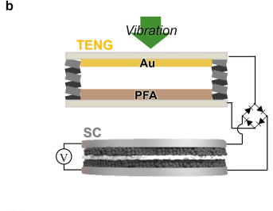
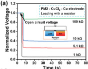
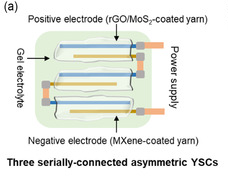
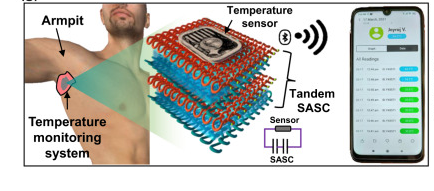
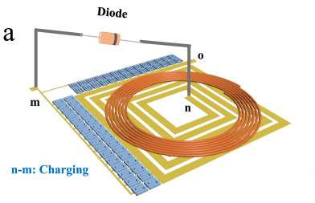
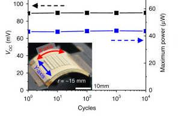
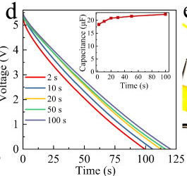

# Figure 15. Integrated arrays, interconnects, energy harvesting, and power management

[Figure index](../README.md) · [Bibliography](../../references/bibliography.md)

## Caption

The panel labels below follow the manuscript. Available source crops are embedded under their corresponding labels.

## Panel guide

### (a) Triboelectric and ionic energy capture

**(a1)** Triboelectric generator, bridge rectifier and supercapacitor test arrangement [[157]](../../references/bibliography.md#ref-157).

Source [[157]](../../references/bibliography.md#ref-157) (Fig. 3, panel b). Cropped from the publisher figure. [CC BY 4.0](https://creativecommons.org/licenses/by/4.0/). [Full attribution and crop record](../panel-provenance.csv).

**(a2)** Time-dependent output voltage of a loaded MXene/PVA ionic thermoelectric generator with a copper electrode [[167]](../../references/bibliography.md#ref-167).

Source [[167]](../../references/bibliography.md#ref-167) (Figure 4, panel a). Cropped from the publisher figure. [CC BY 4.0](https://creativecommons.org/licenses/by/4.0/). [Full attribution and crop record](../panel-provenance.csv).

### (b) Scaling and connecting microsystems

**(b1)** Series connections for three asymmetric yarn supercapacitors [[143]](../../references/bibliography.md#ref-143).

Source [[143]](../../references/bibliography.md#ref-143) (Figure 5, panel a). Cropped from the publisher figure. [CC BY 4.0](https://creativecommons.org/licenses/by/4.0/). [Full attribution and crop record](../panel-provenance.csv).

**(b2)** Short-circuit current with parallel connection of moisture-driven units, before power management [[166]](../../references/bibliography.md#ref-166).

**(b3)** Storage, sensing and wireless telemetry in a wearable temperature-monitoring assembly [[168]](../../references/bibliography.md#ref-168).

Source [[168]](../../references/bibliography.md#ref-168) (Fig. 5, panel g). Cropped from the publisher figure. [CC BY 4.0](https://creativecommons.org/licenses/by/4.0/). [Full attribution and crop record](../panel-provenance.csv).

### (c) Power management comparator

**(c1)** System schematic with rectifier, power management, regulator, sensor and radio.

**(c2)** Measured current waveform through the stages of acquisition and communication [[1]](../../references/bibliography.md#ref-1).

### (d) Energy input and loaded discharge

**(d1)** Wireless charging circuit for the monolithic microsupercapacitor array.

Source [[8]](../../references/bibliography.md#ref-8) (Fig. 5, panel a). Cropped from the publisher figure. [CC BY 4.0](https://creativecommons.org/licenses/by/4.0/). [Full attribution and crop record](../panel-provenance.csv).

**(d2)** Output voltage and maximum power of the compliant thermoelectric generator during repeated bending [[169]](../../references/bibliography.md#ref-169).

Source [[169]](../../references/bibliography.md#ref-169) (Fig. 4, panel g). Cropped from the publisher figure. [CC BY 4.0](https://creativecommons.org/licenses/by/4.0/). [Full attribution and crop record](../panel-provenance.csv).

**(d3)** Loaded array discharge following several charging intervals [[8]](../../references/bibliography.md#ref-8).

Source [[8]](../../references/bibliography.md#ref-8) (Fig. 5, panel d). Cropped from the publisher figure. [CC BY 4.0](https://creativecommons.org/licenses/by/4.0/). [Full attribution and crop record](../panel-provenance.csv).

### (e) Ambient electromagnetic energy recovery and conditioning

**(e1)** Energy pathway from an ambient electromagnetic source through the textile and conditioning to wearable nodes.

**(e2)** Circuit for the wearable textile harvester and energy-management stages.

**(e3)** Measured operating voltage during body-coupled versus air-only energy recovery [[170]](../../references/bibliography.md#ref-170).

### (f) Textile batteries powering a sensor system

**(f1)** Architecture of an all-polymer fiber-battery textile, controller, sensors and Bluetooth readout [[171]](../../references/bibliography.md#ref-171). The field-recovery and fiber-battery cases use different energy inputs. Their circuits expose distinct conditioning and storage requirements before the sensor and radio loads can operate.

## Source and reuse notes

Manuscript source references for the figure are [[1]](../../references/bibliography.md#ref-1), [[8]](../../references/bibliography.md#ref-8), [[143]](../../references/bibliography.md#ref-143), [[157]](../../references/bibliography.md#ref-157), [[166]](../../references/bibliography.md#ref-166), [[167]](../../references/bibliography.md#ref-167), [[168]](../../references/bibliography.md#ref-168), [[169]](../../references/bibliography.md#ref-169), [[170]](../../references/bibliography.md#ref-170), [[171]](../../references/bibliography.md#ref-171).

The published crops carry source-specific Creative Commons terms. For the complete literature montage and any panel without an embedded crop, consult the cited source figure. The supplied manuscript credit language covers its figure references. The original montage files combine panels with different reuse terms.

[Attribution and crop metadata for the shared panels](../panel-provenance.csv).

Manuscript source credits

a1 reproduced with permission from Ref. [[157]](../../references/bibliography.md#ref-157) Copyright 2025, Springer Nature. a2 reproduced with permission from Ref. [[167]](../../references/bibliography.md#ref-167) Copyright 2024, Wiley-VCH GmbH. b1 reproduced with permission from Ref. [[143]](../../references/bibliography.md#ref-143) Copyright 2025, Wiley-VCH GmbH. b2 reproduced with permission from Ref. [[166]](../../references/bibliography.md#ref-166). Copyright 2025, Springer Nature). b3 reproduced with permission from Ref. [[168]](../../references/bibliography.md#ref-168) Copyright 2022, Springer Nature. c1–c2 reproduced with permission from Ref. [[1]](../../references/bibliography.md#ref-1). Copyright 2020, AAAS. d1, d3 reproduced with permission from Ref. [[8]](../../references/bibliography.md#ref-8) Copyright 2024, Springer Nature. d2 reproduced with permission from Ref. [[169]](../../references/bibliography.md#ref-169) Copyright 2020, Springer Nature. e1–e3 reproduced with permission from Ref. [[170]](../../references/bibliography.md#ref-170) Copyright 2025, Springer Nature. f1 reproduced with permission from Ref. [[171]](../../references/bibliography.md#ref-171). Copyright 2026, Wiley-VCH GmbH.

## Scientific explanation

**Power paths and interconnects.** Harvester or receiver output reaches a load through a changing electrical path that may include a bridge, regulator, interconnects, storage, and control electronics. Use loaded waveforms and complete acquisition cycles to assess stored energy, conversion and standby losses, and usable service.
