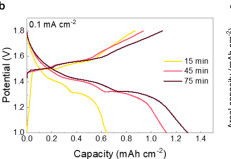
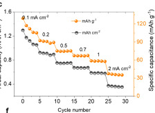
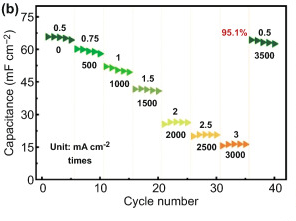
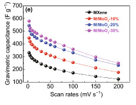
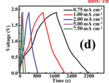
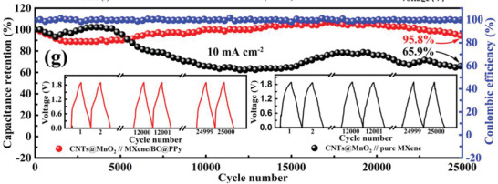
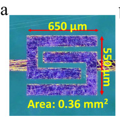
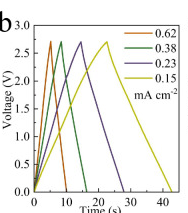
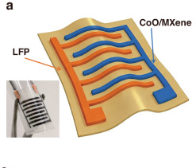
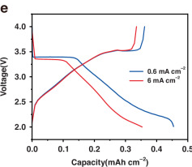

# Figure 16. Electrochemical performance map and theory-to-practice comparison

[Figure index](../README.md) · [Bibliography](../../references/bibliography.md)

## Caption

The panel labels below follow the manuscript. Available source crops are embedded under their corresponding labels.

## Panel guide

### (a) Printed zinc microbattery

**(a1)** Full-cell charge and discharge for three cathode deposition durations at the declared current density.

Source [[22]](../../references/bibliography.md#ref-22) (Figure 4, panel b). Cropped from the publisher figure. [CC BY 4.0](https://creativecommons.org/licenses/by/4.0/). [Full attribution and crop record](../panel-provenance.csv).

**(a2)** Rate-dependent areal and specific capacities on the authors’ respective bases [[22]](../../references/bibliography.md#ref-22).

Source [[22]](../../references/bibliography.md#ref-22) (Figure 4, panel c). Cropped from the publisher figure. [CC BY 4.0](https://creativecommons.org/licenses/by/4.0/). [Full attribution and crop record](../panel-provenance.csv).

### (b) Rate response at different test levels

**(b1)** Areal capacitance over the reported sequence of current densities [[156]](../../references/bibliography.md#ref-156).

Source [[156]](../../references/bibliography.md#ref-156) (Fig. 5, panel b). Cropped from the publisher figure. [CC BY 4.0](https://creativecommons.org/licenses/by/4.0/). [Full attribution and crop record](../panel-provenance.csv).

**(b2)** Rate-dependent gravimetric capacitance of MoO₃/MXene composite electrodes, on an electrode basis [[128]](../../references/bibliography.md#ref-128).

Source [[128]](../../references/bibliography.md#ref-128) (Fig. 3, panel e). Cropped from the publisher figure. [CC BY 4.0](https://creativecommons.org/licenses/by/4.0/). [Full attribution and crop record](../panel-provenance.csv).

### (c) Asymmetric hybrid microcell

**(c1)** Full-cell galvanostatic discharge and charge at several current densities.

Source [[141]](../../references/bibliography.md#ref-141) (Figure 6, panel d). Cropped from the publisher figure. [CC BY 4.0](https://creativecommons.org/licenses/by/4.0/). [Full attribution and crop record](../panel-provenance.csv).

**(c2)** Full-cell cycling at the stated current with initial and final discharge insets [[141]](../../references/bibliography.md#ref-141).

Source [[141]](../../references/bibliography.md#ref-141) (Figure 6, panel g). Cropped from the publisher figure. [CC BY 4.0](https://creativecommons.org/licenses/by/4.0/). [Full attribution and crop record](../panel-provenance.csv).

### (d) Planar MSC footprint and discharge

**(d1)** Optical image and footprint of the patterned microcell.

Source [[8]](../../references/bibliography.md#ref-8) (Fig. 3, panel a). Cropped from the publisher figure. [CC BY 4.0](https://creativecommons.org/licenses/by/4.0/). [Full attribution and crop record](../panel-provenance.csv).

**(d2)** Terminal charge and discharge at a series of areal currents [[8]](../../references/bibliography.md#ref-8).

Source [[8]](../../references/bibliography.md#ref-8) (Fig. 3, panel b). Cropped from the publisher figure. [CC BY 4.0](https://creativecommons.org/licenses/by/4.0/). [Full attribution and crop record](../panel-provenance.csv).

### (e) Lithium microbattery comparator

**(e1)** Interdigitated CoO/MXene–LFP battery geometry.

Source [[151]](../../references/bibliography.md#ref-151) (Fig. 8, panel a). Cropped from the publisher figure. [CC BY 4.0](https://creativecommons.org/licenses/by/4.0/). [Full attribution and crop record](../panel-provenance.csv).

**(e2)** Measured full-cell voltage against areal capacity at the reported currents [[151]](../../references/bibliography.md#ref-151).

Source [[151]](../../references/bibliography.md#ref-151) (Fig. 8, panel e). Cropped from the publisher figure. [CC BY 4.0](https://creativecommons.org/licenses/by/4.0/). [Full attribution and crop record](../panel-provenance.csv).

### (f) Mass loading and rate in an asymmetric MXene cell

**(f1)** Specific capacitance versus current for the two reported areal mass loadings.

**(f2)** Impedance of the asymmetric cell at the corresponding mass loadings.

**(f3)** Capacitance retention and coulombic efficiency of the tested asymmetric cell [[140]](../../references/bibliography.md#ref-140).

### (g) Areal rate and cycling in a planar zinc microbattery

**(g1)** Charge and discharge profiles at the source current densities on the stated footprint basis.

**(g2)** Areal capacity as a function of applied current density for the conversion microbattery.

**(g3)** Capacity and coulombic efficiency during repeated cycling of the conversion microbattery [[13]](../../references/bibliography.md#ref-13). The added comparisons retain the source normalization. Within-study rate or retention changes can guide design, while cross-study rankings require compatible footprints, loadings and voltage limits.

## Source and reuse notes

Manuscript source references for the figure are [[8]](../../references/bibliography.md#ref-8), [[13]](../../references/bibliography.md#ref-13), [[22]](../../references/bibliography.md#ref-22), [[128]](../../references/bibliography.md#ref-128), [[140]](../../references/bibliography.md#ref-140), [[141]](../../references/bibliography.md#ref-141), [[151]](../../references/bibliography.md#ref-151), [[156]](../../references/bibliography.md#ref-156).

The published crops carry source-specific Creative Commons terms. For the complete literature montage and any panel without an embedded crop, consult the cited source figure. The supplied manuscript credit language covers its figure references. The original montage files combine panels with different reuse terms.

[Attribution and crop metadata for the shared panels](../panel-provenance.csv).

Manuscript source credits

a1–a2 reproduced from Ref. [[22]](../../references/bibliography.md#ref-22) (© 2025 the authors (American Chemical Society), CC BY 4.0). b1 reproduced from Ref. [[156]](../../references/bibliography.md#ref-156) (© 2021 the authors (Springer Nature), CC BY 4.0). b2 reproduced from Ref. [[128]](../../references/bibliography.md#ref-128) (© 2020 the authors (Springer Nature), CC BY 4.0). c1–c2 reproduced from Ref. [[141]](../../references/bibliography.md#ref-141) (© 2021 the authors (Wiley-VCH GmbH), CC BY 4.0). d1–d2 reproduced from Ref. [[8]](../../references/bibliography.md#ref-8) (© 2024 the authors (Springer Nature), CC BY 4.0). e1–e2 reproduced from Ref. [[151]](../../references/bibliography.md#ref-151) (© 2026 the authors (Springer Nature), CC BY 4.0). f1–f3 reproduced with permission from Ref. [[140]](../../references/bibliography.md#ref-140). Copyright 2025, the authors (Springer Nature). g1–g3 reproduced with permission from Ref. [[13]](../../references/bibliography.md#ref-13). Copyright 2026, the authors (Springer Nature).

## Scientific explanation

**Full-cell comparisons.** The reported values describe a mix of current densities, mass or footprint denominators, and cell types. The figure supports within-study comparisons such as how loading or rate changes output. Table 3 states the conditions needed to compare observed output with an idealized limit.
