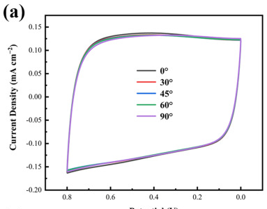
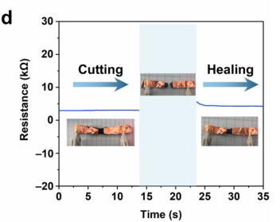
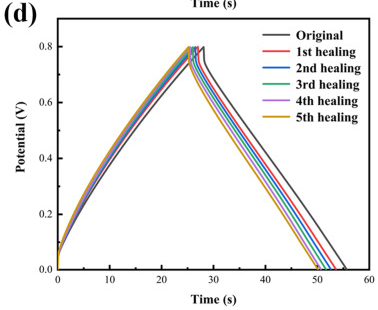
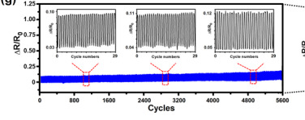
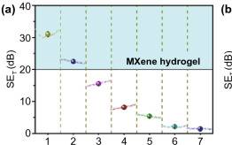
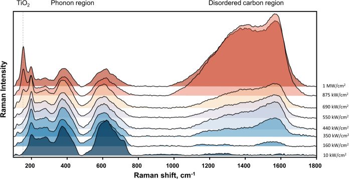
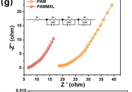
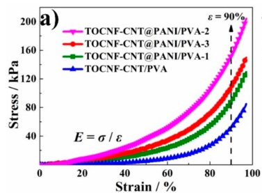

# Figure 17. Coupled mechanical, environmental, and electrochemical failure mechanisms

[Figure index](../README.md) · [Bibliography](../../references/bibliography.md)

## Caption

The panel labels below follow the manuscript. Available source crops are embedded under their corresponding labels.

## Panel guide

### (a) Bending and damage recovery

**(a1)** Voltammograms under the reported bending conditions.

Source [[148]](../../references/bibliography.md#ref-148) (Figure 8, panel a). Cropped from the publisher figure. [CC BY 4.0](https://creativecommons.org/licenses/by/4.0/). [Full attribution and crop record](../panel-provenance.csv).

**(a2)** Electronic resistance of the MXene composite hydrogel during cutting and recontact [[92]](../../references/bibliography.md#ref-92).

Source [[92]](../../references/bibliography.md#ref-92) (Figure 6, panel d). Cropped from the publisher figure. [CC BY 4.0](https://creativecommons.org/licenses/by/4.0/). [Full attribution and crop record](../panel-provenance.csv).

**(a3)** Galvanostatic response over successive healing events [[148]](../../references/bibliography.md#ref-148).

Source [[148]](../../references/bibliography.md#ref-148) (Figure 8, panel d). Cropped from the publisher figure. [CC BY 4.0](https://creativecommons.org/licenses/by/4.0/). [Full attribution and crop record](../panel-provenance.csv).

### (b) Battery recovery and sensing endurance

**(b1)** Resistance response of a protected MXene electronic skin during repeated pressure loading [[176]](../../references/bibliography.md#ref-176).

Source [[176]](../../references/bibliography.md#ref-176) (FIGURE 3, panel g). Cropped from the publisher figure. [CC BY 4.0](https://creativecommons.org/licenses/by/4.0/). [Full attribution and crop record](../panel-provenance.csv).

**(b2)** Full-cell response across sequential cutting and repair cycles [[152]](../../references/bibliography.md#ref-152).

### (c) Ageing and electronic pathways

**(c1)** Evolution of normalized conductivity during ageing.

**(c2)** Galvanostatic comparison of fresh and aged electrodes [[17]](../../references/bibliography.md#ref-17).

### (d) Environmental and deformation comparators

**(d1)** Evolution of electromagnetic shielding for the aqueous hydrogel [[35]](../../references/bibliography.md#ref-35).

Source [[35]](../../references/bibliography.md#ref-35) (Fig. 5, panel a). Cropped from the publisher figure. [CC BY 4.0](https://creativecommons.org/licenses/by/4.0/). [Full attribution and crop record](../panel-provenance.csv).

**(d2)** Capacitance retention of the CNT–rGO fabric cell across the stated bending protocol [[23]](../../references/bibliography.md#ref-23).

### (e) Chemistry-specific degradation diagnostic

**(e1)** Single-axis Raman spectrum series across laser powers identifies the effects of the probe exposure [[76]](../../references/bibliography.md#ref-76).

Source [[76]](../../references/bibliography.md#ref-76) (Figure 4, panel whole). Cropped from the publisher figure. [CC BY 4.0](https://creativecommons.org/licenses/by/4.0/). [Full attribution and crop record](../panel-provenance.csv).

### (f) Mechanical and impedance diagnostics

**(f1)** Impedance response and fitted circuit of the compared supercapacitor formulations [[81]](../../references/bibliography.md#ref-81).

Source [[81]](../../references/bibliography.md#ref-81) (Figure 3, panel g). Cropped from the publisher figure. [CC BY 4.0](https://creativecommons.org/licenses/by/4.0/). [Full attribution and crop record](../panel-provenance.csv).

**(f2)** Compression curves for nanocellulose and CNT-reinforced conductive gels, a non-MXene comparison [[177]](../../references/bibliography.md#ref-177).

Source [[177]](../../references/bibliography.md#ref-177) (Figure 3, panel a). Cropped from the publisher figure. [CC BY 4.0](https://creativecommons.org/licenses/by/4.0/). [Full attribution and crop record](../panel-provenance.csv).

### (g) Environmental challenge during sensor deformation

**(g1)** Water retention of the hydrogel sensor in the stated warm and humid test.

**(g2)** Sensor resistance as a function of deformation and time in the environmental chamber.

**(g3)** Relative resistance traces during cyclic loading over the six-hour exposure [[101]](../../references/bibliography.md#ref-101). The chamber exposure characterizes sensor stability during deformation under the reported conditions. A charge-storage device would also require simultaneous electrochemical cycling and package inspection.

## Source and reuse notes

Manuscript source references for the figure are [[17]](../../references/bibliography.md#ref-17), [[23]](../../references/bibliography.md#ref-23), [[35]](../../references/bibliography.md#ref-35), [[76]](../../references/bibliography.md#ref-76), [[81]](../../references/bibliography.md#ref-81), [[92]](../../references/bibliography.md#ref-92), [[101]](../../references/bibliography.md#ref-101), [[148]](../../references/bibliography.md#ref-148), [[152]](../../references/bibliography.md#ref-152), [[176]](../../references/bibliography.md#ref-176), [[177]](../../references/bibliography.md#ref-177).

The published crops carry source-specific Creative Commons terms. For the complete literature montage and any panel without an embedded crop, consult the cited source figure. The supplied manuscript credit language covers its figure references. The original montage files combine panels with different reuse terms.

[Attribution and crop metadata for the shared panels](../panel-provenance.csv).

Manuscript source credits

a1, a3 reproduced with permission from Ref. [[148]](../../references/bibliography.md#ref-148) Copyright 2021, MDPI. a2 reproduced with permission from Ref. [[92]](../../references/bibliography.md#ref-92) Copyright 2025, MDPI. b1 reproduced with permission from Ref. [[176]](../../references/bibliography.md#ref-176) Copyright 2025, Wiley-VCH GmbH. b2 reproduced with permission from Ref. [[152]](../../references/bibliography.md#ref-152). Copyright 2024, Royal Society of Chemistry. c1–c2 reproduced with permission from Ref. [[17]](../../references/bibliography.md#ref-17). Copyright 2025, Royal Society of Chemistry. d1 reproduced with permission from Ref. [[35]](../../references/bibliography.md#ref-35) Copyright 2022, Springer Nature. d2 reproduced with permission from Ref. [[23]](../../references/bibliography.md#ref-23). Copyright 2021, American Chemical Society. e1 reproduced with permission from Ref. [[76]](../../references/bibliography.md#ref-76) Copyright 2024, American Chemical Society. f1 reproduced with permission from Ref. [[81]](../../references/bibliography.md#ref-81) Copyright 2025, MDPI. f2 reproduced with permission from Ref. [[177]](../../references/bibliography.md#ref-177) Copyright 2020, MDPI. g1–g3 reproduced with permission from Ref. [[101]](../../references/bibliography.md#ref-101). Copyright 2025, Springer Nature.

## Scientific explanation

**Coupled failure.** Voltage response, impedance, structural observations, and mechanical tests can localize degradation to a gel, current path, seal, or active material. Resistance recovery of a sensor and usable-energy recovery of a packaged cell are separate endpoints. Claims should retain the stated temperature, hydration, exposure, and mechanical histories.
