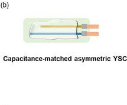
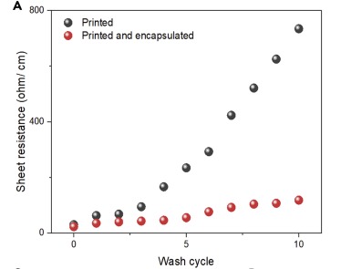
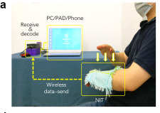
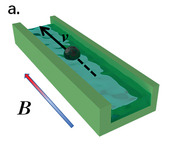
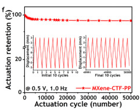
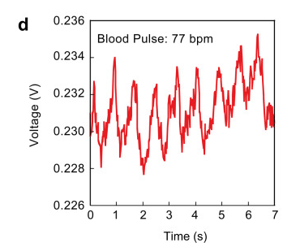
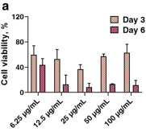

# Figure 18. Application-readiness ladder for wearable and soft-mechatronic platforms

[Figure index](../README.md) · [Bibliography](../../references/bibliography.md)

## Caption

The panel labels below follow the manuscript. Available source crops are embedded under their corresponding labels.

## Panel guide

### (a) Textile storage and conductors

**(a1)** Capacitance-matched asymmetric yarn supercapacitor with gel electrolyte [[143]](../../references/bibliography.md#ref-143).

Source [[143]](../../references/bibliography.md#ref-143) (Figure 4, panel b). Cropped from the publisher figure. [CC BY 4.0](https://creativecommons.org/licenses/by/4.0/). [Full attribution and crop record](../panel-provenance.csv).

**(a2)** Resistance of printed textile conductors with and without encapsulation during washing [[100]](../../references/bibliography.md#ref-100).

Source [[100]](../../references/bibliography.md#ref-100) (Figure 2, panel A). Cropped from the publisher figure. [CC BY 4.0](https://creativecommons.org/licenses/by/4.0/). [Full attribution and crop record](../panel-provenance.csv).

### (b) Network integration and powered wear

**(b1)** Wearable textile circuit transmitting body-motion data to external equipment [[180]](../../references/bibliography.md#ref-180).

Source [[180]](../../references/bibliography.md#ref-180) (Fig. 5, panel a). Cropped from the publisher figure. [CC BY 4.0](https://creativecommons.org/licenses/by/4.0/). [Full attribution and crop record](../panel-provenance.csv).

**(b2)** On-body demonstration of the battery-powered garment system [[6]](../../references/bibliography.md#ref-6).

### (c) Actuation demand and endurance

**(c1)** Magnetic-field-driven straight motion of the MXene hydrogel microrobot [[187]](../../references/bibliography.md#ref-187).

Source [[187]](../../references/bibliography.md#ref-187) (Figure 6, panel a). Cropped from the publisher figure. [CC BY 4.0](https://creativecommons.org/licenses/by/4.0/). [Full attribution and crop record](../panel-provenance.csv).

**(c2)** Retention of electro-ionic actuation over repeated cycles under the reported external drive [[122]](../../references/bibliography.md#ref-122).

Source [[122]](../../references/bibliography.md#ref-122) (5, panel f). Cropped from the publisher figure. [CC BY 4.0](https://creativecommons.org/licenses/by/4.0/). [Full attribution and crop record](../panel-provenance.csv).

### (d) Electro-ionic motion under applied voltage

**(d1)** Four-wing active surface under applied voltage, viewed from above and from the side [[121]](../../references/bibliography.md#ref-121).

**(d2)** Peak-to-peak displacement under applied voltage for the Nb₂C actuator and its polymer reference [[186]](../../references/bibliography.md#ref-186).

### (e) Skin-mounted systems and readout

**(e1)** microfabrication and proposed body-mounted system operation [[2]](../../references/bibliography.md#ref-2).

**(e2)** Physiological signal acquired by a self-powered optical comparator [[194]](../../references/bibliography.md#ref-194).

Source [[194]](../../references/bibliography.md#ref-194) (Fig. 4, panel d). Cropped from the publisher figure. [CC BY 4.0](https://creativecommons.org/licenses/by/4.0/). [Full attribution and crop record](../panel-provenance.csv).

### (f) Skin-contact evidence

**(f1)** Keratinocyte viability at the reported concentrations and exposure times for one MXene formulation [[4]](../../references/bibliography.md#ref-4).

Source [[4]](../../references/bibliography.md#ref-4) (7, panel a). Cropped from the publisher figure. [CC BY 4.0](https://creativecommons.org/licenses/by/4.0/). [Full attribution and crop record](../panel-provenance.csv).

**(f2)** Photograph and detail of the patterned sensor assembly [[178]](../../references/bibliography.md#ref-178).

### (g) Sustained hydrogel skin contact and wireless readout

**(g1)** Continuous ECG with a reinforced hydrogel electrode during office work, rest and walking.

**(g2)** Hydrogel electrode interface with on-body Bluetooth EEG readout [[179]](../../references/bibliography.md#ref-179).

### (h) Wireless microneedle platform comparator

**(h1)** Wearable photoelectrochemical microneedle architecture with optical excitation, electronics and separate battery.

**(h2)** Photograph of the integrated wireless microneedle platform on the arm [[195]](../../references/bibliography.md#ref-195). The skin-interface examples establish signal continuity and readout functions under specific tests. The microneedle system includes a separate battery and optical excitation stage.

## Source and reuse notes

Manuscript source references for the figure are [[2]](../../references/bibliography.md#ref-2), [[4]](../../references/bibliography.md#ref-4), [[6]](../../references/bibliography.md#ref-6), [[100]](../../references/bibliography.md#ref-100), [[121]](../../references/bibliography.md#ref-121), [[122]](../../references/bibliography.md#ref-122), [[143]](../../references/bibliography.md#ref-143), [[178]](../../references/bibliography.md#ref-178), [[179]](../../references/bibliography.md#ref-179), [[180]](../../references/bibliography.md#ref-180), [[186]](../../references/bibliography.md#ref-186), [[187]](../../references/bibliography.md#ref-187), [[194]](../../references/bibliography.md#ref-194), [[195]](../../references/bibliography.md#ref-195).

The published crops carry source-specific Creative Commons terms. For the complete literature montage and any panel without an embedded crop, consult the cited source figure. The supplied manuscript credit language covers its figure references. The original montage files combine panels with different reuse terms.

[Attribution and crop metadata for the shared panels](../panel-provenance.csv).

Manuscript source credits

a1 reproduced with permission from Ref. [[143]](../../references/bibliography.md#ref-143) Copyright 2025, Wiley-VCH GmbH. a2 reproduced with permission from Ref. [[100]](../../references/bibliography.md#ref-100) Copyright 2022, Elsevier. b1 reproduced with permission from  Ref. [[180]](../../references/bibliography.md#ref-180) Copyright 2021, Springer Nature. b2 reproduced with permission from Ref. [[6]](../../references/bibliography.md#ref-6). Copyright 2021, AAAS. c1 reproduced with permission from Ref. [[187]](../../references/bibliography.md#ref-187) Copyright 2024, Wiley-VCH GmbH. c2 reproduced with permission from Ref. [[122]](../../references/bibliography.md#ref-122) Copyright 2025, American Chemical Society. d1 adapted with permission from Ref. [[121]](../../references/bibliography.md#ref-121). Copyright 2025, Wiley-VCH GmbH. d2 reproduced with permission from Ref. [[186]](../../references/bibliography.md#ref-186) Copyright 202,6 Royal Society of Chemistr. e1 reproduced with permission from Ref. [[2]](../../references/bibliography.md#ref-2). Copyright 2025, Springer Nature. e2 reproduced with permission from Ref. [[194]](../../references/bibliography.md#ref-194) Copyright 2021, Springer Nature. f1 reproduced with permission from Ref. [[4]](../../references/bibliography.md#ref-4) Copyright 2025, American Chemical Society. f2 reproduced with permission from Ref. [[178]](../../references/bibliography.md#ref-178). Copyright 2021, AAAS. g1–g2 reproduced with permission from Ref. [[179]](../../references/bibliography.md#ref-179). Copyright 2026,  Springer Nature. h1–h2 reproduced with permission from Ref. [[195]](../../references/bibliography.md#ref-195). Copyright 2026, Springer Nature.

## Scientific explanation

**Application readiness.** The examples range from components and material endpoints to garment-level telemetry and powered wear. A material test, a protected storage module, and a working load under repeated exposure each support a distinct claim. System evaluation should identify what supplies energy to the measurement, control, communication, and actuation stages.
