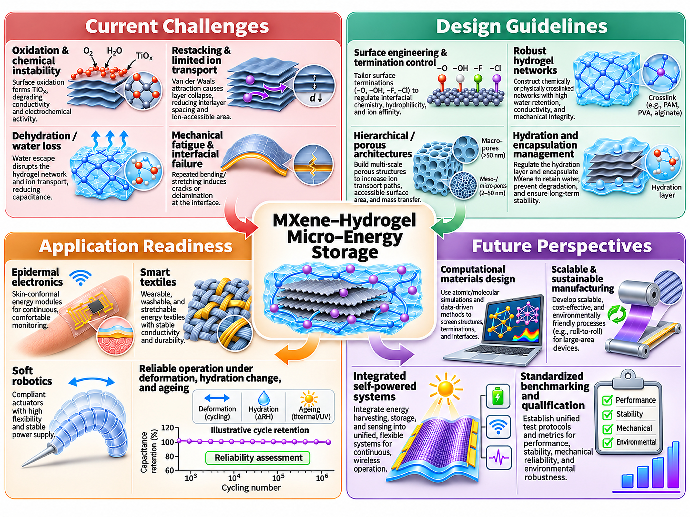

# Figure 20. Comprehensive overview of the key challenges and developmental considerations associated with MXene–hydrogel-based micro-energy storage technologies

[Figure index](../README.md) · [Bibliography](../../references/bibliography.md)

[Original JPEG (5,792 × 4,344 px)](Figure-20.jpg) · [Editable PowerPoint](Figure-20.pptx)

## Caption

**Current challenges.** The upper-left quadrant connects surface oxidation, restacking, water loss, and interfacial fatigue to possible losses of electronic continuity, ion access, and mechanical integrity.

**Design guidelines.** The upper-right quadrant depicts termination control, crosslinked gel networks, hierarchical porosity, and encapsulation. The review classifies pores below 2 nm as micropores, 2–50 nm as mesopores, and above 50 nm as macropores.

**Application readiness.** The lower-left quadrant places the material in epidermal electronics, smart textiles, and soft robotics. The schematic retention plot and exposure icons represent combined testing during deformation, hydration change, and ageing.

**Future perspectives.** The lower-right quadrant links computational screening, scalable production, integrated harvesting and storage, and qualification protocols. These are research directions and reporting priorities.

## Attribution

The manuscript credits the author with creating and finalizing this schematic in PowerPoint. It discloses AI assistance for conceptual planning and visual layout. The visual contains idealized mechanisms and illustrative plots.

## Scientific explanation

**Design and qualification.** Chemical stability, hydration, percolation, and interface fatigue interact during service. The roadmap links controllable material and packaging variables to representative electrical and mechanical tests. Its retention curve illustrates a reporting objective, and the application examples are prospective design contexts.
